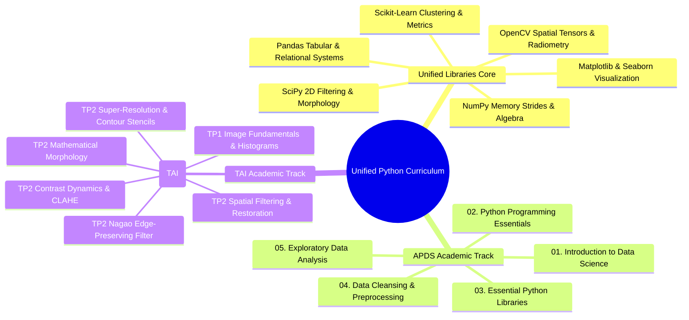
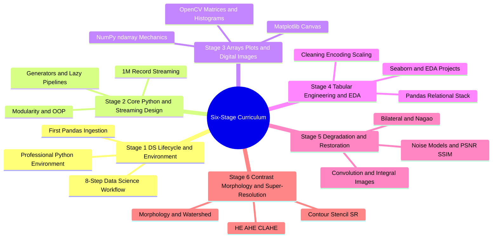

# 00. Master Curriculum Roadmap

## 1. Curriculum Architecture
This knowledge base unifies **Data Science & Machine Learning (APDS)** with **Advanced Image Processing & Computer Vision (TAI)** on top of a single, shared Python computational foundation.

**The single-source rule for libraries:** every library concept (NumPy, Matplotlib, Seaborn, Pandas, OpenCV, SciPy, Scikit-Learn) is documented once, in depth, in the `Libraries/` section — a stage-indexed API lookup, not a syllabus. The academic chapters reference those notes — adding only a brief in-context reminder of what a function does — so no library topic is ever documented twice. The learning **order** is the six progressive stage path of section 3 below.

---

## 2. Master Navigation Index

### 2.1 Unified Library Learning Path (`Libraries/`)
*API reference notes — each library surface is documented once here and referenced from the chapters. Look up any library by stage in [[00. Library Learning Roadmap]]; the learning order itself is the six-stage path in section 3.*

**Handwritten-exam companions:** every library note has a `.5` exam-defense companion in `Libraries/`; the series opens with core Python — [[00.5. Core Python Handwritten Construction Guide]] (problem-to-code method, clean multiline syntax, unsolved paper drills with executed answer keys).

| Note | Core Topics Covered |
| :--- | :--- |
| [[01. NumPy Foundations - Memory Layout, ndarray Anatomy, and Array Instantiation]] | Contiguous C-buffers, shapes, strides, data types |
| [[02. NumPy Array Manipulation - Slicing, Strides, Shapes, and Vectorized Indexing]] | Strided memory views, boolean masking, `np.where`, `np.clip`, Z-scores |
| [[03. Matplotlib Core Architecture - Figure, Axes, and Canvas Visualization Mechanics]] | Figure, Axes, subplots, `imshow` with `cmap`/`vmin`/`vmax` |
| [[04. NumPy Mathematical Engine - Vectorization, ufuncs, and Broadcasting Rules]] | Vectorized operations, multi-axis reduction, broadcasting, `np.fft` |
| [[05. NumPy Linear Algebra and Advanced Numerical Computation]] | Matrix products, inverses, determinants, linear systems |
| [[06. Pandas Structural Primitives - Series and DataFrame Architecture]] | 1D Series, 2D DataFrames, BlockManager memory |
| [[07. Pandas Data Ingestion, Inspection, and Type Coercion]] | Parsing CSV/Excel, dtypes, memory audit, null checks |
| [[08. Pandas Indexing, Slicing, and Query Mechanics (loc, iloc, query, at)]] | Label vs position slicing, query engine, fast scalar lookups |
| [[09. Pandas Data Cleansing - Handling Nulls, Deduplication, and String Normalization]] | Imputation, deduplication, vectorized string methods, `get_dummies` |
| [[10. Matplotlib and Seaborn Statistical Plotting for Tabular Data]] | Histograms, KDE, box plots, violin plots, correlation heatmaps, `plot_surface` |
| [[10.6. Plotly Express and Basemap - Interactive and Geographic Figures]] | Chapter 4 Part 2 (pp. 17-23): `px.bar` / `px.scatter` / `px.line` with `hover_data`, HTML export versus Matplotlib, conceptual Basemap maps (`merc`, coastlines, `m(lon, lat)`) |
| [[11. Pandas Grouping, Split-Apply-Combine, and Statistical Aggregations]] | GroupBy mechanics, multi-metric agg, transform windowing |
| [[12. Pandas Relational Operations - Joins, Merging, and Concatenation]] | SQL-style joins, vertical/horizontal concatenation |
| [[13. Pandas Data Reshaping - Pivoting, Unpivoting, Stacking, and Melting]] | Wide vs long formats, pivot tables, melting |
| [[14. Pandas Temporal Mechanics - Time Series and Datetime Calculations]] | DatetimeIndex, resampling, rolling averages, shifts |
| [[15. OpenCV Core Architecture - Matrix Representation, Channels, and Color Constellations]] | BGR memory layout, `cvtColor`, channel splitting, saturated arithmetic |
| [[16. Image Spatial Transformations - Interpolation, Scaling, Cropping, and Affine Warping]] | ROI cropping, nearest/bilinear/bicubic resampling, rotations |
| [[17. SciPy Signal and Spatial Operations - 2D Filtering and Morphology]] | `convolve2d` modes/boundaries, `ndimage` binary morphology |
| [[18. Visual Frequency and Radiometry - Histograms, Equalization, AHE, and CLAHE]] | PMF, CDF, dynamic range expansion, global equalization, CLAHE |
| [[19. Spatial Image Restoration - Noise Models, Linear Convolution, and Fast Integral Filters]] | AWGN, salt-and-pepper noise, box/Gaussian filters, integral images |
| [[20. Non-Linear and Edge-Preserving Filtering - Median, Bilateral, and Nagao Filters]] | Order-statistic median, bilateral filtering, 9-region Nagao |
| [[21. Mathematical Morphology - Set Theory, Structuring Elements, and Thinning]] | Erosion, dilation, opening, closing, connected components, Zhang-Suen thinning |
| [[22. Objective Image Quality Assessment - MSE, PSNR, and SSIM Metrics]] | Mathematical derivations for MSE, PSNR (dB), and SSIM |
| [[23. Scikit-Learn Primitives - Clustering, Dimensionality, and Metrics]] | `KMeans` clustering, `jaccard_score` IoU, `StandardScaler` |
| [[24. Super-Resolution and Edge-Adaptive Interpolation - Pascal Getreuer Contour Stencils]] | Total Variation along curves, 12 directional stencils, 2x/4x SR |

---

### 2.2 Academic Chapters

#### Chapter 01: Introduction to Data Science
- [[01.1. Data Science Foundations and the 8-Step Data Science Workflow]]
- [[01.2. The Modern Data Ecosystem and Professional Roles]]
- [[01.3. Setting Up the Professional Python and Data Science Environment]]
- [[01.4. Tutorial 02 - Hospital Patient Cohort Initialization and Environment Audit]]

#### Chapter 02: Python Programming Essentials
- [[02.1. Python Runtime, Dynamic Typing, and Core Primitives]]
- [[02.2. Python Lists, Sequence Operations, and Internal Memory Architecture]]
- [[02.3. Dictionaries, Sets, Tuples, and High-Performance Collections]]
- [[02.4. Control Flow, Conditionals, and Comprehensions Mastery]]
- [[02.5. Exhaustive Guide to Iteration, Iterables, and the Iterator Protocol]]
- [[02.6. Generators, Lazy Evaluation, and Asynchronous Streaming Pipelines]]
- [[02.7. The 1 Million Records Memory Explosion Autopsy and Production Streaming Solutions]]
- [[02.8. Object-Oriented Programming and Class Design Patterns]]
- [[02.9. Robust Exception Handling and Resource Management]]
- [[02.10. Code Modularity, Packaging, and Standard Library Systems]]
- [[02.11. Tutorial 03 - Modular Sales Inventory Processing Pipeline]]
- [[02.12. Tutorial 03 - Student Cohort Generation and Statistical Analysis System]]

#### Chapter 03: Essential Python Libraries
- [[03.1. Contextual Data Science Computing with NumPy and Pandas]]
- [[03.2. Tutorial 04 - Multi-City Temperature Array Analysis with NumPy]]
- [[03.3. Tutorial 04 - Academic Performance Statistical Analysis with NumPy and Matplotlib]]
- [[03.4. Tutorial 04 - Hospital Department Patient Analytics with Pandas]]
- [[03.5. Tutorial 04 - Longitudinal Sales Forecasting Project]]

#### Chapter 04: Data Cleansing and Preprocessing
- [[04.1. Missing Data Mechanisms and Statistical Imputation]]
- [[04.2. Statistical Outlier Detection and Consistency Rectification]]
- [[04.3. Categorical Feature Encoding and Text Normalization]]
- [[04.4. Feature Scaling, Standardization, and Normalization Theory]]
- [[04.5. Tutorial 05 - End-to-End Medical Cohort Preprocessing Pipeline]]
- [[04.6. Tutorial 05 - Titanic Predictive Modeling Pipeline and Classifier Evaluation]]

#### Chapter 05: Exploratory Data Analysis
- [[05.1. Exploratory Data Analysis Principles, Distributions, and Correlation Metrics]]

#### TAI Track: Advanced Image Processing
- [[00. Advanced Image Processing Index and Curriculum MOC]]
- [[09.1. TP1 - Digital Image Acquisition, Matrix Topologies, and Fixed Thresholding]]
- [[09.2. TP1 - Spatial Transformations, ROI Extraction, and Multi-Channel Histograms]]
- [[09.3. TP2 Part 1 - Discrete Noise Models and Spatial Convolution Smoothing]]
- [[09.4. TP2 Part 1 Homework - Fast Integral Filtering and Adaptive Smoothing]]
- [[09.5. TP2 Part 2 - Edge-Preserving Non-Linear Smoothing with Nagao Filter]]
- [[09.6. TP2 Part 3 - Mathematical Morphology, Cell Counting, and Skeletonization]]
- [[09.7. TP2 Part 4 - Contrast Dynamics, Histogram Equalization, and CLAHE]]
- [[09.8. TP2 Part 5 - Single-Frame Super-Resolution and Contour Stencils]]

### 2.3 Chapter Question Banks (`Quiz/`)
Every chapter, laboratory sequence, and library topic has a dedicated interactive question bank in the puzzle callout format under the root `Quiz/` directory (492 questions across 20 banks). Start from [[00. Quiz Master Index]], or jump directly:
- APDS track: [[Quiz 01 - Introduction to Data Science]], [[Quiz 02 - Python Programming Essentials]], [[Quiz 03 - Essential Python Libraries]], [[Quiz 04 - Data Cleansing and Preprocessing]], [[Quiz 05 - Exploratory Data Analysis]]
- TAI track: [[Quiz 01 - Image Foundations and Discretization]] through [[Quiz 10 - Worked Analytical Exercises and Projects]] (one bank per TAI chapter)
- Library track: [[Quiz L01 - NumPy]], [[Quiz L02 - Pandas]], [[Quiz L03 - Matplotlib and Seaborn]], [[Quiz L04 - OpenCV, SciPy, and Image Processing Libraries]], [[Quiz L05 - Scikit-Learn]]

---

## 3. Course Roadmap: The Six Progressive Stages

This roadmap provides the operational sequence for traversing the knowledge base. It enforces a strict dependency rule: **No mathematical model, computational method, or library syntax is deployed in an academic chapter or lab before being fully defined and derived in the foundational notes.** Both tracks (APDS and TAI) are organised around the same six progressive stages; libraries appear when a stage needs them.

### Stage-by-Stage Architecture

| Stage | Goal | APDS labs | TAI labs | Vault chapters | Library notes introduced |
| :--- | :--- | :--- | :--- | :--- | :--- |
| **1 — DS lifecycle & environment** | Frame the data-science workflow, set up the professional toolchain, ingest a first table | `APDS/00_Introduction_Exercises`, `APDS/01_Hospital_Data_Setup` | `TAI/00_Environment_and_NumPy_Foundations` | Ch. 01 (all) | — |
| **2 — Core Python & streaming design** | Modular code, OOP, generators, and streaming designs that survive one million records | `APDS/02_Sales_Inventory_Pipeline`, `APDS/03_Student_Simulation_Analytics`, `APDS/04_One_Million_Record_Streaming` | — | Ch. 02 (all) | [[00.5. Core Python Handwritten Construction Guide]] |
| **3 — 2D/3D arrays, plots & digital images** | One mental model for n-dimensional buffers: array statistics, canvas plotting, image matrices | `APDS/05_NumPy_Scientific_Computing` (TP4 Ex 1–2) | `TAI/01_TP1_Image_Fundamentals` (Exo 2–5) | Ch. 03 (03.1–03.3) | 01–02, 04–05 (NumPy), 03 (Matplotlib), 15–16 (OpenCV basics) |
| **4 — Tabular engineering, preprocessing & EDA** | The relational Pandas stack, then cleaning, encoding, scaling, and exploratory analysis | `APDS/06_Hospital_Department_Analytics` (TP4 Ex 3–4), `APDS/07_Monthly_Sales_Forecasting` (TP4 project), `APDS/08_Data_Preprocessing_and_Modeling` (TP5), `APDS/09_Iris_Exploratory_Data_Analysis` | — | Ch. 03 (03.4–03.5), Ch. 04, Ch. 05 | 06–14 (Pandas), 10 (Seaborn), 10.6 (Plotly/Basemap), 23 (Sklearn prep) |
| **5 — Degradation, restoration & spatial/spectral filtering** | Noise as a stochastic process, objective quality metrics, linear and fast filtering, edge-preserving smoothing | — | `TAI/02_TP2_Noise_and_Spatial_Filtering` (Exo 1–3) | Image Processing Ch. 02; worked ex. 10.1 | 17 (SciPy convolution), 19 (restoration/integral), 20 + 25 + 26 (Bilateral/Nagao), 22 (MSE/PSNR/SSIM) |
| **6 — Contrast, morphology, segmentation & super-resolution** | Radiometric conditioning, shape analysis, clustering, and edge-adaptive reconstruction | — | `TAI/03_TP2_Morphology_and_Contrast` (Exo 4–5), `TAI/04_TP2_Super_Resolution` (Exo 6) | Image Processing Ch. 04–06, 08; worked ex. 10.2–10.4 | 18 (CLAHE), 21 (morphology), 23 (KMeans), 24 (contour stencils) |

### Cross-Track Bridges

The two tracks are one curriculum, and the stages deliberately share machinery:

- **Stage 3 — arrays ↔ images.** The temperature and grade matrices of `APDS/05_NumPy_Scientific_Computing` and the `ndarray` mechanics of [[01. NumPy Foundations - Memory Layout, ndarray Anatomy, and Array Instantiation]] are the *same objects* as the BGR images of [[15. OpenCV Core Architecture - Matrix Representation, Channels, and Color Constellations]]: contiguous buffers, shapes, strides, dtype-driven memory. A `uint8` image is an array whose rendering is the `imshow` canvas of [[03. Matplotlib Core Architecture - Figure, Axes, and Canvas Visualization Mechanics]]; `TAI/01_TP1_Image_Fundamentals` (Exo 2–5) is the applied continuation of the NumPy stage on real pixels.
- **Stage 4 cleaning ↔ Stage 6 radiometry.** Tabular cleaning ([[04.1. Missing Data Mechanisms and Statistical Imputation]], [[04.2. Statistical Outlier Detection and Consistency Rectification]], [[04.4. Feature Scaling, Standardization, and Normalization Theory]]) and radiometric conditioning ([[18. Visual Frequency and Radiometry - Histograms, Equalization, AHE, and CLAHE]]) solve the same problem in different domains — conditioning observed values so structure dominates: imputation ↔ dead-pixel repair, outlier clipping ↔ histogram tail clipping, Min-Max scaling ↔ dynamic-range expansion, quantile-based scaling ↔ CLAHE's adaptive redistribution.

---
