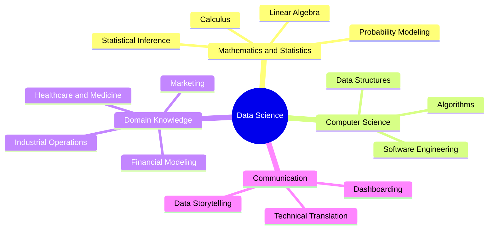
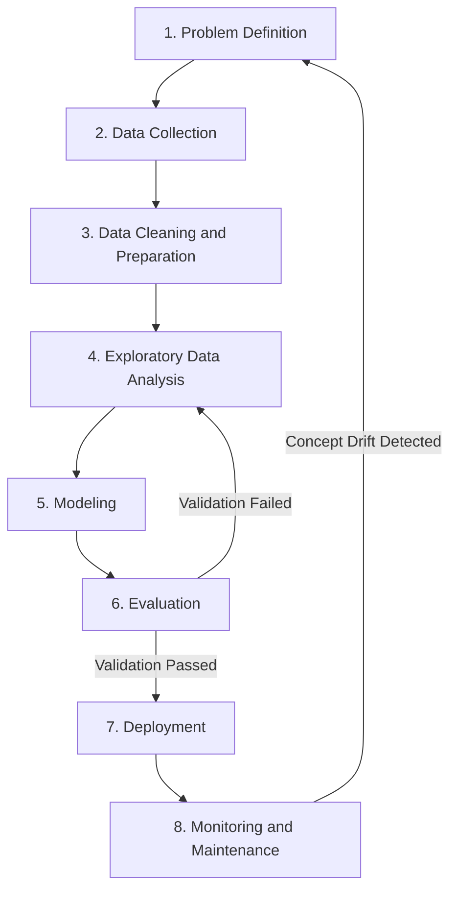

# 01.1. Data Science Foundations and the 8-Step Data Science Workflow

## 1. Chapter Overview
Data Science extracts actionable knowledge from raw, structured, and
unstructured data. This note covers the foundations of data science, its
core identity, operational value, and the instructor's **8-step Data Science
Workflow** — the process model used throughout the course.

> [!info] Terminology note — not CRISP-DM
> Chapter 1 names its process model the **"Data Science Workflow"** (8
> steps). It is *not* the Cross-Industry Standard Process for Data Mining
> (CRISP-DM), the older 6-phase industry model some textbooks teach. If an
> external source maps these course steps onto CRISP-DM phases, treat the
> course wording as authoritative for exams.

## 2. Learning Objectives
- Formulate a precise, formal definition of Data Science.
- Deconstruct the multi-disciplinary pillars supporting data-driven discovery.
- Trace the eight steps of the Data Science Workflow.
- Differentiate between descriptive, diagnostic, predictive, and prescriptive analytics.
- Name the three skill areas of a data scientist and the alternative languages (R, Julia).
- List the main Python data-science tools and situate Python among them.

## 3. Prerequisites
- Basic familiarity with high-level computing concepts.
- Understanding of empirical experimentation and the scientific method.

## 4. Theoretical Foundations

### 4.1 Conceptual Architecture of Data Science
Data Science is an interdisciplinary field combining mathematical analysis,
computational algorithms, and contextual domain expertise to discover
patterns and build predictive engines from complex data corpora.

### 4.2 The 8-Step Data Science Workflow
The lifecycle of an empirical data-science project is an **iterative loop**
of eight steps — later steps feed back into earlier ones (a failed
evaluation returns you to exploration; detected drift returns you to the
problem definition):

1. **Problem Definition**: Translating ambiguous operational or clinical
   challenges into concrete, measurable analytical objectives.
2. **Data Collection**: Extracting records across internal transaction
   databases, external APIs, telemetry streams, and flat file archives.
3. **Data Cleaning and Preparation**: Resolving incomplete records, imputing
   null values, removing duplicates, and standardizing incompatible text
   encodings.
4. **Exploratory Data Analysis (EDA)**: Calculating summary statistics and
   charting variable distributions to understand patterns before modeling.
5. **Modeling**: Choosing and training algorithmic representations
   (e.g. Logistic Regression, Decision Trees) to isolate mathematical patterns.
6. **Evaluation**: Assessing model predictions against unseen validation
   data using domain-appropriate metrics (e.g. accuracy, confusion matrix).
7. **Deployment**: Putting the validated model into production use so its
   predictions reach decision-makers.
8. **Monitoring and Maintenance**: Continually auditing the deployed system
   for data drift, concept drift, and performance regressions.

*Supplementary — beyond core exam scope:* production deployment is often
discussed in industry with containerization (Docker) and REST microservices
(e.g. FastAPI); the course stops at the conceptual Deployment step.

### 4.3 The Three Skill Areas of a Data Scientist
Chapter 1 structures the data scientist's competence across three
complementary skill areas:

| Skill area | What it covers | Course evidence |
| :--- | :--- | :--- |
| **Mathematics & Statistics** | Probability, inference, linear algebra, descriptive statistics | EDA (Ch6), outlier theory (Ch5), evaluation metrics |
| **Programming & Computer Science** | Python, data structures, libraries, engineering hygiene | Ch3 Python Essentials, Ch4 Libraries, all TPs |
| **Domain Knowledge & Communication** | Understanding the field that generated the data; telling its story | Hospital-cohort TPs (TP2, TP4, TP5), TP1 role exercise |

The intersection of the three is what distinguishes a data scientist from a
pure statistician (missing the engineering), a pure developer (missing the
statistics), or a domain expert (missing both).

### 4.4 Data Science Languages — Python, R, and Julia
Chapter 1 presents three languages used for data science:

| Language | Character | Strengths | Trade-offs |
| :--- | :--- | :--- | :--- |
| **Python** | General-purpose | Huge ecosystem (NumPy, pandas, scikit-learn), gentle syntax, production-friendly | Not the fastest at raw loops (vectorize instead) |
| **R** | Statistics-first | Built for statistical modeling and graphics (`ggplot2`, CRAN) | Narrower general-programming ecosystem |
| **Julia** | Numerical computing | Near-C speed with high-level syntax, designed for science | Younger ecosystem, smaller community |

The course **chooses Python** — every chapter, tutorial, and practical uses
it — but a data scientist should recognize R and Julia by name and role.

### 4.5 Python Data-Science Tools
Beyond the core libraries (NumPy, pandas, Matplotlib, Seaborn, scikit-learn
— see [[01.3. Setting Up the Professional Python and Data Science Environment]]),
Chapter 1 names tools that scale Python to bigger data:

- **PySpark** — distributed data processing on clusters (Spark).
- **Dask** — parallel and larger-than-memory computing with pandas-like APIs.
- **SQLAlchemy** — Pythonic access to SQL databases (replaces raw SQL strings).

*Supplementary — beyond core exam scope:* the wider big-data ecosystem also
includes Hadoop, Kafka, and Airflow; they are context, not course content.

### 4.6 Python Language Overview
Python is a high-level, interpreted, dynamically typed language whose
readability makes it the default teaching language for data science:

- **Interpreted**: runs line-by-line without a separate compile step — ideal
  for notebooks.
- **Dynamically typed**: variable types follow the assigned values
  (`x = 3` then `x = "text"` is legal); flexibility that demands discipline
  (Ch3 typing rules).
- **Multi-paradigm**: procedural, object-oriented, and functional styles all
  work (Ch3 covers each).
- **Batteries included**: the standard library ships modules for files, math,
  dates, and JSON (Ch3 §built-in modules).
- **Ecosystem**: the DS stack installs on top with pip/conda (Ch2), turning
  Python into a complete analysis environment.

### 4.7 Data Science vs. ML, AI, Big Data, and BI
Data Science overlaps but does not coincide with its neighbouring fields —
see the comparative matrix in
[[01.2. The Modern Data Ecosystem and Professional Roles]], which also maps
the five role archetypes and worked classification scenarios.

## 5. TP1 — Introduction Exercises
The Chapter 1 practical (TP1) exercises this vocabulary on two scenarios:
five domain projects mapped to their data types and workflow steps, and a
5-year heart-disease risk study decomposed into professional roles. It is
implemented in the lab as `APDS/00_Introduction_Exercises`
(`notebooks/01_introduction_exercises.ipynb`).

## 6. Connections to Other Topics
- Relates to [[01.2. The Modern Data Ecosystem and Professional Roles]] for role division across this workflow.
- Environment setup for every step: [[01.3. Setting Up the Professional Python and Data Science Environment]].
- Connects directly to practical execution in [[01.4. Tutorial 02 - Hospital Patient Cohort Initialization and Environment Audit]].
- Step 3 (Cleaning) is developed in depth by the Data Cleansing chapter; Step 4 (EDA) by the EDA chapter.

## 7. Summary
Data Science combines statistics, computer science, and domain knowledge
into an iterative **8-step Data Science Workflow** — Problem Definition →
Data Collection → Cleaning → EDA → Modeling → Evaluation → Deployment →
Monitoring. Python is the course's working language, complemented by R and
Julia in the wider field, and the workflow's steps reappear as the
structure of every tutorial that follows.

---
