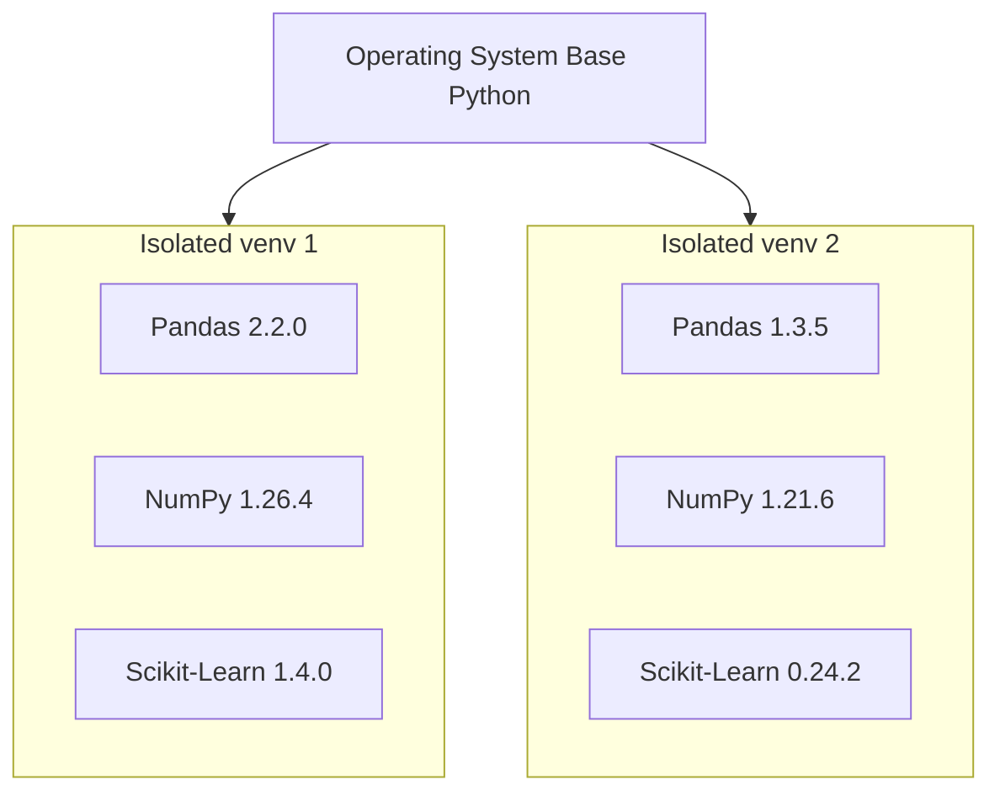

# 01.3. Setting Up the Professional Python and Data Science Environment

## 1. Overview
A reliable, reproducible programming environment prevents dependency conflicts and enables smooth team collaboration. This note covers installing Python (python.org vs. Anaconda), IDE selection, runtime isolation, package management with `pip` and `conda`, Git version control standards, and the main data-science libraries named by the course.

## 2. Installing Python — python.org vs. Anaconda

Two official installation routes lead to a working Python; they differ in what
they bundle:

| Route | What you get | When to choose it |
| :--- | :--- | :--- |
| **python.org installer** | The CPython interpreter alone; every package is added afterwards with `pip` | Lightweight setup, full control over each library version |
| **Anaconda distribution** | Python + 250+ pre-installed scientific packages (NumPy, pandas, Matplotlib, Jupyter, Spyder…) + the `conda` package manager | Fastest route to a complete data-science stack, especially on Windows |

Both end at the same place — a `python` on your `PATH` and a package
installer. The course projects work identically under either route; the lab
repository (`APSD_TAI_LAB`) uses the python.org + `venv` + `requirements.txt`
route so the toolchain is pinned and reproducible.

## 3. Integrated Development Environments (IDEs)

| Environment | Primary Design Target | Key Strengths | Limitations |
| :--- | :--- | :--- | :--- |
| **Jupyter Notebook** | Exploratory Data Analysis, prototyping, data visualization | Interactive step-by-step execution, inline plots, Markdown notes | Difficult to version control (`.ipynb` JSON diffs), not suited for production APIs |
| **VS Code** | General-purpose software engineering and data science | Extensible ecosystem, integrated terminal, Git integration, remote SSH execution | Requires configuring plugins and interpreters |
| **PyCharm Professional** | Large-scale, production Python applications | Advanced refactoring, deep debugging, built-in database tools | Resource-intensive, commercial license for full feature set |
| **Spyder** | Scientific and statistical computation | MATLAB-like interface, variable explorer, array inspector | Less flexible for general software development |
| **JupyterLab** | Notebook-centric data science workbench | Tabbed notebooks, file browser, terminal and code consoles in one UI | Browser-based; heavier than a plain notebook for quick edits |

(Spyder ships with Anaconda; Jupyter Notebook/Lab ship with both routes once
`jupyter` is installed.)

## 4. Main Data-Science Libraries

The course names these as the core Python stack; the vault dedicates a
reference note to each (links in the table). All install with one
`pip install` line:

```bash
pip install numpy pandas matplotlib seaborn scikit-learn jupyter
```

| Library | Role in the workflow | Vault reference |
| :--- | :--- | :--- |
| **NumPy** | N-dimensional arrays, vectorized math, linear algebra | [[01. NumPy Foundations - Memory Layout, ndarray Anatomy, and Array Instantiation]] |
| **Pandas** | DataFrames, ingestion, cleaning, aggregation, reshaping | [[06. Pandas Structural Primitives - Series and DataFrame Architecture]] |
| **Matplotlib** | Foundational plotting (figures, axes, every chart type) | [[03. Matplotlib Core Architecture - Figure, Axes, and Canvas Visualization Mechanics]] |
| **Seaborn** | Statistical charts built on Matplotlib (distributions, heatmaps) | [[10. Matplotlib and Seaborn Statistical Plotting for Tabular Data]] |
| **Scikit-learn** | Classical ML: preprocessing, clustering, classification, metrics | [[23. Scikit-Learn Primitives - Clustering, Dimensionality, and Metrics]] |
| **Statsmodels** | Statistical models with inference focus (tests, regression summaries) | — (statistics support library, named in Chapter 2) |
| **XGBoost** | Gradient-boosted trees, tabular prediction competitions | — (advanced modeling library, named in Chapter 2) |
| **LightGBM** | Microsoft's fast gradient boosting on large datasets | — (advanced modeling library, named in Chapter 2) |

The last three are named by Chapter 2 as part of the modern DS stack; the
course projects use the first five, so the vault's deep reference notes cover
those, and Statsmodels/XGBoost/LightGBM remain install-on-demand
(`pip install statsmodels xgboost lightgbm`).

## 5. Virtual Environment Mechanics

Python installs libraries globally by default, placing compiled packages inside a shared system directory. Running multiple projects on a single global installation often leads to dependency conflicts.



### Dependency Management: `pip` vs. `conda`

| Feature | `pip` (Python Package Installer) | `conda` (Anaconda / Miniconda) |
| :--- | :--- | :--- |
| **Package Ecosystem** | Exclusively Python packages via PyPI | Multi-language packages (Python, C++, R, CUDA) |
| **Dependency Resolution** | Resolves Python-level dependencies | System-level binary resolver, resolves shared C libraries |
| **Environment Tooling** | Requires separate tooling (`venv`, `virtualenv`) | Native, integrated environment management |
| **Binary Portability** | Relies on pre-compiled wheels; falls back to local compiler | Distributes pre-compiled platform-specific binaries |

## 6. Standard Project Directory Structure

```text
my_data_science_project/
│
├── data/
│   ├── raw/             # Immutable raw data extracts
│   └── processed/       # Cleaned, engineered datasets
│
├── notebooks/           # Jupyter notebooks for exploration
│   └── exploratory.ipynb
│
├── src/                 # Production Python modules
│   ├── __init__.py
│   ├── data_loader.py
│   └── features.py
│
├── models/              # Serialized model artifacts (.pkl, .onnx)
├── outputs/             # Exported figures, plots, and metrics
├── tests/               # Unit and integration test scripts
│
├── .gitignore           # Git ignore declarations
├── requirements.txt     # Pip package dependency file
├── environment.yml      # Conda environment definition file
└── README.md            # Project documentation and reproduction steps
```

## 7. Environment Setup Commands

### Using `venv` (Native Python)
```bash
# Initialize project directory
mkdir ClinicalRiskSystem
cd ClinicalRiskSystem

# Initialize isolated virtual environment
python -m venv env

# Activate environment
# On Linux / macOS:
source env/bin/activate
# On Windows (cmd.exe):
env\Scripts\activate.bat
# On Windows (PowerShell):
.\env\Scripts\activate.ps1

# Upgrade installer and install dependencies
pip install --upgrade pip
pip install numpy pandas matplotlib seaborn scikit-learn jupyter

# Export exact dependencies to file
pip freeze > requirements.txt

# Reconstruct environment on another machine
pip install -r requirements.txt
```

### Using `conda`
```bash
# Create isolated environment with specific Python version
conda create --name clinical_env python=3.10 -y

# Activate environment
conda activate clinical_env

# Install required packages
conda install -c conda-forge numpy pandas matplotlib seaborn scikit-learn jupyter -y

# Export environment definition to YAML
conda env export > environment.yml

# Reconstruct environment on another machine
conda env create -f environment.yml
```

## 8. Git Version Control Workflow

Version control records every project state and enables collaboration on
GitHub. The full Chapter 2 workflow:

```bash
# One-time setup: turn the project folder into a Git repository
git init

# Keep generated artifacts out of the history
echo -e "env/\n__pycache__/\n*.pyc\n.ipynb_checkpoints/" > .gitignore

# Stage and record the first snapshot
git add .
git commit -m "Initialize project structure and environment"

# Connect to a GitHub repository and publish
git remote add origin https://github.com/<user>/<project>.git
git push -u origin main
```

Day-to-day cycle — status → stage → commit → push:

```bash
git status                      # what changed since the last commit
git add notebooks/analysis.ipynb
git commit -m "Add patient cohort summary statistics"
git push                        # publish commits to GitHub
```

Useful inspection commands: `git log --oneline` (history),
`git diff` (unstaged changes), `git checkout -- <file>` (discard local
edits), `git clone <url>` (get someone else's repository).

## 9. Connections to Other Topics
- Applied in [[01.4. Tutorial 02 - Hospital Patient Cohort Initialization and Environment Audit]] (TP2 Steps 4–5 exercise this exact workflow).
- Library architecture detailed in [[00. Library Learning Roadmap]].

---
