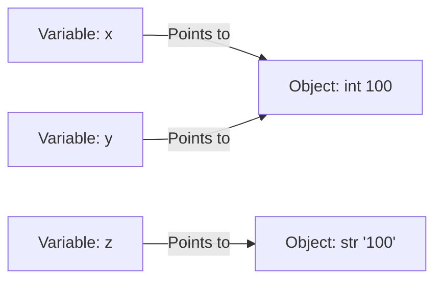

# 02.1. Python Runtime, Dynamic Typing, and Core Primitives

## 1. Overview
This note covers Python's memory model, dynamic typing mechanisms, type casting behavior, primitive data representations, and the string toolkit (methods, slicing, f-strings).

## 2. Theoretical Foundations: Dynamic Typing and Objects
In Python, variables do not hold values directly. Instead, variables are names bound to objects living on the heap — the runtime tracks each object's type and reference count for garbage collection.

> [!tip] CPython internals — supplementary, beyond core exam scope
> In the CPython implementation every object is a `PyObject` C struct
> (`ob_refcnt` reference count, `ob_type` type pointer, value fields), and
> `int`/`float`/`str`/`bool` map to `PyLongObject`, `PyFloatObject`,
> `PyUnicodeObject`, `PyBoolObject`. Knowing the struct names is *not*
> required by Chapter 3 — what matters is the model: names → objects, types
> carried by the objects, immutable `int`/`float`/`str`/`bool`.



### Core Data Types

| Type | Mutability | Example | Description |
| :--- | :--- | :--- | :--- |
| `int` | Immutable | `42` | Arbitrary precision signed integer |
| `float` | Immutable | `9.81` | IEEE 754 double-precision floating point (64-bit) |
| `str` | Immutable | `"Algiers"` | Unicode character sequence |
| `bool` | Immutable | `True`, `False` | Subclass of `int` (`True == 1`, `False == 0`) |

### Explicit Type Casting Mechanics
External datasets often ingest numeric features as strings. Converting these strings requires explicit type casting:

```python
x = "100"          # str
y = int(x)         # str -> int (Parses numeric string to integer)
z = float(x)       # str -> float (Converts to 100.0)
a = str(z)         # float -> str ("100.0")
b = bool(a)        # Non-empty strings evaluate to True; "" evaluates to False

print(f"Values: x={x}, y={y}, z={z}, a='{a}', b={b}")
print(f"Types:  y={type(y)}, z={type(z)}, b={type(b)}")
```

## 3. Python Operators and Truthiness

### Identity (`is`) vs. Equality (`==`)
- **Equality (`==`)**: Evaluates whether the **values** referenced by two objects are equal.
- **Identity (`is`)**: Evaluates whether two variables reference the **exact same object** (`id(a) == id(b)`).

```python
a = [1, 2, 3]
b = [1, 2, 3]

print(a == b)  # True: Identical values
print(a is b)  # False: Distinct objects
```

> [!tip] Small integer caching — supplementary, beyond core exam scope
> CPython pre-allocates singleton integer objects for values between -5 and
> 256, so `x = 256; y = 256; x is y` is `True` while the same with `257` is
> typically `False`. This explains *why* `is` "sometimes works" for ints —
> and why equality (`==`), never identity, is the correct comparison. An
> implementation detail, not course content.

## 4. Strings and f-Strings (Chapter 3 toolkit)

Strings are immutable sequences: every "modifying" method returns a **new**
string. Chapter 3's method set:

```python
s = "  Data Science  "

print(s.lower())            # "  data science  "     Case conversions
print(s.upper())            # "  DATA SCIENCE  "
print(s.strip())            # "Data Science"         Whitespace trimming
print(s.replace(" ", "_"))  # "__Data_Science__"     Substring replacement
print(s.startswith("  Da")) # True                   Prefix test
print(s.find("cie"))        # 8 (index) / -1 if absent    Substring search
print(s.split())            # ['Data', 'Science']    Split on whitespace
print(", ".join(["a", "b"]))# "a, b"                 Join with separator
```

### String slicing and reversal
Strings support the same slice syntax as lists (`s[start:stop:step]`):

```python
name = "Python"

print(name[0])       # 'P'    first character
print(name[-1])      # 'n'    last character
print(name[0:3])     # 'Pyt'  characters 0..2
print(name[::-1])    # 'nohtyP'  reversed (step -1)
print(len(name))     # 6
```

### f-Strings — formatted string literals
The f-string embeds any expression inside `{}`:

```python
patient = "Amina"
age = 46
bp = 139.5

print(f"Patient {patient}, age {age}")            # Patient Amina, age 46
print(f"Next year: {age + 1}")                    # Expressions allowed
print(f"BP: {bp:.1f} mmHg")                       # BP: 139.5 mmHg (1 decimal)
print(f"{age:03d}")                               # 046 (zero-padded width 3)
print(f"{0.256:.0%}")                             # 26% (percentage format)
```

## 5. Connections to Other Topics
- Forms the basis for compound data structures in [[02.2. Python Lists, Sequence Operations, and Internal Memory Architecture]].
- Applied to DataFrame columns in [[07. Pandas Data Ingestion, Inspection, and Type Coercion]].
- Text normalization workflows in [[09. Pandas Data Cleansing - Handling Nulls, Deduplication, and String Normalization]].

---
