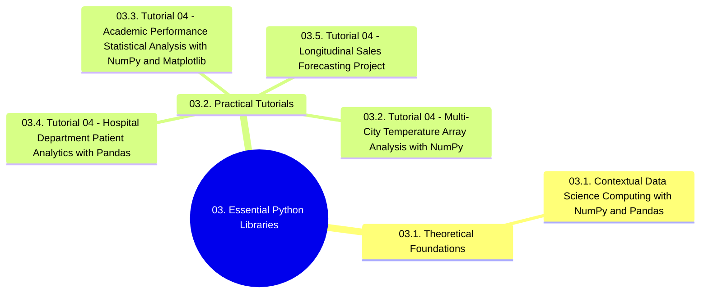

# 03. Essential Python Libraries - Chapter Overview and Navigation

## 1. Chapter Structure

## 2. Navigational Table of Contents

### 03.1. Theoretical Foundations
- [[03.1. Contextual Data Science Computing with NumPy and Pandas]]

### 03.2. Practical Tutorials
- [[03.2. Tutorial 04 - Multi-City Temperature Array Analysis with NumPy]]
- [[03.3. Tutorial 04 - Academic Performance Statistical Analysis with NumPy and Matplotlib]]
- [[03.4. Tutorial 04 - Hospital Department Patient Analytics with Pandas]]
- [[03.5. Tutorial 04 - Longitudinal Sales Forecasting Project]]

## 3. Prerequisite Library Links
- Connects to foundations in [[00. Library Learning Roadmap]]
- Deep-dive references for the two flagship edge-preserving operators: [[25. Bilateral Filtering - Complete Mathematical Theory, Implementation, and Practice]] and [[26. Nagao Filtering - Multi-Implementation Reference with Hardcoded Kernels, Vectorized, and Convolution Approaches]]

## 4. Stage Placement in the Unified Curriculum
Tutorials 03.2–03.3 belong to **Stage 3 — 2D/3D arrays, plots & digital images** (lab: `APDS/05_NumPy_Scientific_Computing`); tutorials 03.4–03.5 belong to **Stage 4 — Tabular engineering, preprocessing & EDA** (labs: `APDS/06_Hospital_Department_Analytics`, `APDS/07_Monthly_Sales_Forecasting`) — see [[00. Master Curriculum Roadmap]] §3.

**Cross-track bridge (Stage 3, arrays ↔ images):** the matrices built in these tutorials are the same `ndarray` objects as the BGR images of [[15. OpenCV Core Architecture - Matrix Representation, Channels, and Color Constellations]] — contiguous buffers, shapes, strides. `TAI/01_TP1_Image_Fundamentals` (Exo 2–5) is the applied continuation of this stage on real pixels.