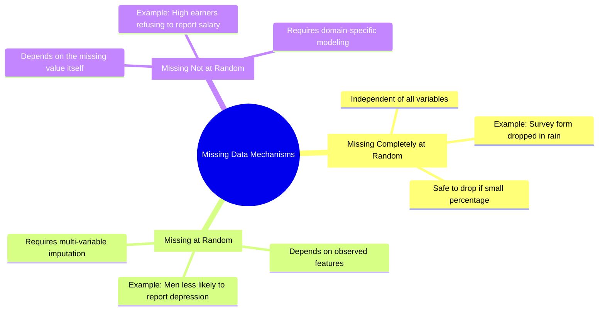

# 04.1. Missing Data Mechanisms and Statistical Imputation

## 1. Overview
Real-world datasets frequently contain missing values. Choosing the right imputation strategy requires understanding **why** data is missing. This note covers the missingness audit, the three primary missingness mechanisms, and compares common statistical imputation techniques including forward/backward fill and the scikit-learn `SimpleImputer` vs `KNNImputer`.

## 2. Missing Data Mechanisms



1. **Missing Completely at Random (MCAR)**: The probability of an observation being missing is completely independent of both observed and unobserved features.
2. **Missing at Random (MAR)**: The probability of missingness depends on observed features in the dataset, but not on the unobserved missing value itself.
3. **Missing Not at Random (MNAR)**: The probability of missingness depends directly on the unobserved value itself.

## 3. Missingness Audit
Before choosing a strategy, quantify *where* and *how much* is missing. The audit answers three questions: is anything missing at all, how much per column, and is the missingness concentrated in specific rows?

```python
import numpy as np
import pandas as pd
import seaborn as sns
import matplotlib.pyplot as plt

raw_data = {
    'PatientID': ['P001', 'P002', 'P003', 'P004', 'P005', 'P006', 'P007', 'P008', 'P009', 'P010'],
    'Age': [25, np.nan, 65, 50, 80, 120, 45, 38, np.nan, 55],
    'BloodPressure': [120, 130, np.nan, 110, 200, 95, 125, 118, 122, 210],
    'Cholesterol': [200, 180, 250, 190, 300, 180, np.nan, 210, 220, 350],
    'Gender': ['Female', 'male', 'Male', 'female', 'MALE', None, 'female', 'female', 'FEMALE', 'Male'],
    'Diagnosis': ['Diabetes', 'Healthy', 'Diabetes', 'Healthy', 'Hypertension', 'Healthy', 'Diabetes', 'Healthy', None, 'Hypertension']
}
df = pd.DataFrame(raw_data)

# 1. Is anything missing at all? (single boolean for the whole frame)
print("any missing:", df.isnull().values.any())

# 2. How much per column - count and percentage side by side
audit = pd.DataFrame({
    "n_missing": df.isnull().sum(),
    "pct_missing": (df.isnull().mean() * 100).round(1),
})
print(audit)

# 3. Where - a boolean heatmap exposes row/column patterns at a glance
sns.heatmap(df.isnull(), cbar=False, cmap="viridis")
plt.title("Missingness map (yellow = missing)")
plt.show()
```

The audit reads: `Age` (2), `BloodPressure` (1), `Cholesterol` (1), `Gender` (1), `Diagnosis` (1) - every column except `PatientID`. One trap: a literal Python `None` in a dict-built frame is already `NaN`, but the same value stored as the *string* `"None"` in a CSV is invisible to `isnull()` until text normalization converts it - the pipeline of [[04.5. Tutorial 05 - End-to-End Medical Cohort Preprocessing Pipeline]] handles both.

## 4. Imputation Strategies Comparison

| Method | Best Suited For | Advantages | Disadvantages |
| :--- | :--- | :--- | :--- |
| **Row Deletion (`dropna`)** | Minimal missingness (<5%) under MCAR | Simple, preserves original relationships | Discards valid data, introduces bias under MAR/MNAR |
| **Mean Imputation** | Continuous symmetric (normally distributed) features | Simple to compute, maintains sample size | Underestimates variance, distorts correlations |
| **Median Imputation** | Continuous skewed features with outliers | Robust to outliers | Distorts covariance and correlation structures |
| **Mode Imputation** | Categorical and discrete features | Simple to apply to non-numeric data | Overrepresents majority classes |
| **Forward/Backward Fill (`ffill`/`bfill`)** | Ordered data (time series, logs) | Respects temporal locality, no statistics needed | Propagates stale values; wrong for unordered rows |
| **KNN Imputation** | Multi-variable datasets with correlated features | Preserves relationships across variables | Computationally expensive ($O(n^2)$), scale-sensitive |

## 5. Forward and Backward Fill
For **ordered** data, the nearest valid observation is often the best estimate: `ffill()` propagates the last seen value forward, `bfill()` pulls the next seen value backward.

```python
glucose = pd.DataFrame({
    "time": pd.date_range("2024-01-01 08:00", periods=6, freq="h"),
    "mg_dL": [5.6, np.nan, np.nan, 6.1, np.nan, 5.9],
})

glucose["ffill"] = glucose["mg_dL"].ffill()   # last observation carried forward
glucose["bfill"] = glucose["mg_dL"].bfill()   # next observation carried backward
print(glucose)
```

The fill assumes the value changed as little as possible between consecutive rows. On shuffled or unordered data that assumption is meaningless - sort by the time column first, and remember `ffill` cannot fill a leading gap (nothing before it) while `bfill` cannot fill a trailing one.

## 6. Scikit-Learn Imputation: SimpleImputer vs KNNImputer
`SimpleImputer` replaces every gap with one per-column statistic (median, mean, most frequent); `KNNImputer` estimates each gap from the `n_neighbors` most similar complete rows, which preserves multivariate relationships - at the cost of distance computations and **scale sensitivity**: neighbours are found with Euclidean distances, so a column measured in hundreds dominates one measured in units.

```python
from sklearn.impute import SimpleImputer, KNNImputer
from sklearn.preprocessing import StandardScaler

demo = pd.DataFrame({
    "Age": [25, np.nan, 65, 50, 80],
    "BloodPressure": [120, 130, np.nan, 110, 200],
})

# SimpleImputer: one statistic per column (median), scale plays no role
simple = SimpleImputer(strategy="median")
print("SimpleImputer (median):\n", simple.fit_transform(demo))

# KNNImputer on the raw columns: distances are dominated by BloodPressure
knn = KNNImputer(n_neighbors=2)
print("KNNImputer raw:\n", knn.fit_transform(demo))

# KNNImputer on standardized columns: both columns contribute equally
scaled = StandardScaler().fit_transform(demo)
print("KNNImputer scaled:\n", KNNImputer(n_neighbors=2).fit_transform(scaled))
```

Decision rule: use `SimpleImputer` as the default and for categorical features (`most_frequent`); switch to `KNNImputer` only when features are correlated, the dataset is small enough for the $O(n^2)$ cost, and the columns are scaled first.

## 7. Connections to Other Topics
- Next step: [[04.2. Statistical Outlier Detection and Consistency Rectification]].
- Applied in [[04.5. Tutorial 05 - End-to-End Medical Cohort Preprocessing Pipeline]].
- The audit heatmap pattern generalizes to the EDA views of [[05.1. Exploratory Data Analysis Principles, Distributions, and Correlation Metrics]].

---
