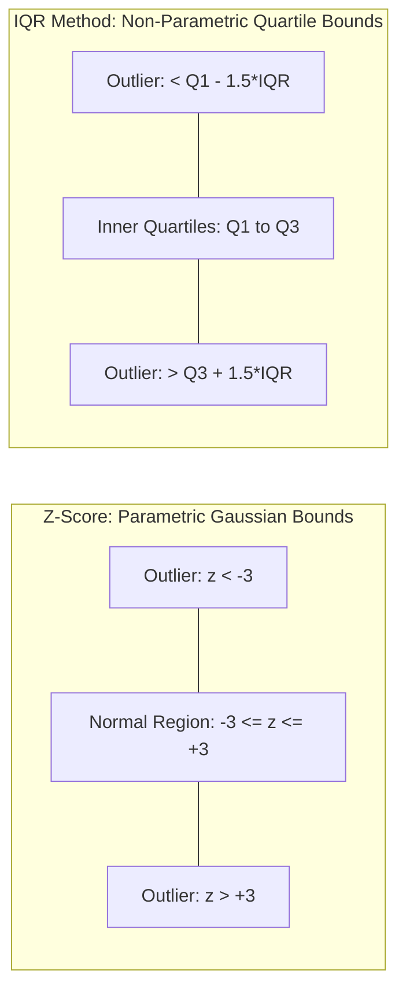

# 04.2. Statistical Outlier Detection and Consistency Rectification

## 1. Overview
Outliers can distort statistical metrics and degrade machine learning model performance. This note covers parametric (Z-score) and non-parametric (Interquartile Range) detection, the four standard treatments compared side by side, duplicate detection and removal, and type/consistency validation (`to_numeric`, `to_datetime`, `astype('category')`, `NaT`/`NaN`).

## 2. Detection Techniques



### Z-Score Method (Parametric)
Calculates how many standard deviations a data point lies away from the mean. It assumes the data follows a normal (Gaussian) distribution:

$$z = \frac{x - \mu}{\sigma}$$

Data points with an absolute Z-score exceeding 3 ($|z| > 3$) are typically flagged as outliers.

### Interquartile Range (IQR) Method (Non-Parametric)
A robust outlier detection method that makes no assumptions about the underlying distribution:

$$\text{IQR} = Q_3 - Q_1$$

$$\text{Lower Fence} = Q_1 - 1.5 \times \text{IQR}$$

$$\text{Upper Fence} = Q_3 + 1.5 \times \text{IQR}$$

Values outside these fences are classified as outliers.

```python
import numpy as np
import pandas as pd

def cap_outliers_iqr(series: pd.Series) -> pd.Series:
    """Caps outliers within IQR boundaries (Winsorization)."""
    Q1 = series.quantile(0.25)
    Q3 = series.quantile(0.75)
    IQR = Q3 - Q1
    lower_fence = Q1 - 1.5 * IQR
    upper_fence = Q3 + 1.5 * IQR
    return series.clip(lower=lower_fence, upper=upper_fence)
```

## 3. The Four Treatments Compared
The chapter's reference figure puts the standard treatments of one skewed column side by side: leave it, remove the outlier rows, cap (winsorize) at the fences, or log-transform. Each panel shows the same data after one treatment:

```python
import matplotlib.pyplot as plt
from scipy.stats import zscore

rng = np.random.default_rng(7)
costs = np.concatenate([rng.lognormal(6.0, 0.4, 400), [500, 900, 1500]])  # 3 planted extremes

vals = pd.Series(costs, name="cost")
z = zscore(vals)
trimmed = vals[np.abs(z) <= 3]              # treatment 2: drop |z| > 3 rows
capped = cap_outliers_iqr(vals)             # treatment 3: winsorize at IQR fences
logged = np.log1p(vals)                     # treatment 4: compress the tail

fig, axes = plt.subplots(2, 2, figsize=(10, 7))
for ax, data, title in zip(
    axes.flat,
    [vals, trimmed, capped, logged],
    ["1. Original (with outliers)", "2. Trimmed (|z| <= 3)",
     "3. Capped at IQR fences", "4. log1p transformed"],
):
    ax.hist(data, bins=30)
    ax.set_title(title)
plt.tight_layout()
plt.show()

print(f"rows kept by trimming: {len(trimmed)} / {len(vals)}")
print(f"max after capping: {capped.max():.1f} (was {vals.max():.1f})")
```

The z-score view of the same data makes the threshold explicit - each point is plotted against its $z$ value, and the $|z| = 3$ band marks the parametric boundary:

```python
fig, ax = plt.subplots(figsize=(8, 4))
ax.scatter(vals.index, z, s=12, c=np.abs(z) > 3, cmap="coolwarm")
ax.axhline(3, linestyle="--")
ax.axhline(-3, linestyle="--")
ax.set_xlabel("row index")
ax.set_ylabel("z-score")
ax.set_title("z-score per row (red = |z| > 3)")
plt.show()
```

Trimming deletes information but is honest when the extremes are entry errors; capping keeps every row and bounds the leverage; the log transform reshapes the whole distribution rather than touching individual points - choose per the Recommended-Actions table of [[05.1. Exploratory Data Analysis Principles, Distributions, and Correlation Metrics]].

## 4. Duplicate Detection and Removal
Exact duplicates inflate the weight of the copied rows in every statistic. `duplicated()` flags them, and `drop_duplicates()` removes them - both accept `subset=` to key on specific columns only:

```python
orders = pd.DataFrame({
    "invoice": ["A-100", "A-101", "A-101", "A-102", "A-100"],
    "item": ["keyboard", "mouse", "mouse", "monitor", "keyboard"],
    "qty": [2, 1, 1, 1, 3],
})
print(orders, "\n")
print("full-row duplicates:\n", orders.duplicated(), "\n")
print("invoice-only duplicates:\n", orders.duplicated(subset=["invoice"]), "\n")
print(orders.drop_duplicates(subset=["invoice"], keep="first"))
```

Reading rules: `keep="first"` (default) marks all but the first occurrence, `keep=False` marks every copy for audit, and `subset=` is the tool of choice when a business key (invoice number, patient ID) must be unique even if other columns differ.

## 5. Type and Consistency Validation
Columns read from CSV or user input arrive as strings until proven otherwise. Validation coerces them and sends failures to sentinel nulls instead of raising: `to_numeric` produces `NaN`, `to_datetime` produces `NaT` - both are detected by `isnull()`:

```python
messy = pd.DataFrame({
    "reading": ["120", "118", "one-forty", "200", ""],
    "visit": ["2024-01-05", "2024-02-11", "not-a-date", "2024-03-02", "2024-04-18"],
})

messy["reading_num"] = pd.to_numeric(messy["reading"], errors="coerce")
messy["visit_date"] = pd.to_datetime(messy["visit"], errors="coerce")
print(messy, "\n")
print("rows with NaN or NaT:", messy[["reading_num", "visit_date"]].isnull().any(axis=1).sum())

city = pd.Series(["Oran", "Alger", "Oran", "Annaba"], name="city")
print("as category:", city.astype("category").cat.categories.tolist())
```

`astype("category")` after validation compresses repeated strings and fixes the category set; `errors="coerce"` plus an `isnull()` count is the audit pattern that tells *how many* values failed conversion - the failed rows are then inspected individually before any fix is decided.

> **Instructor PDF quirk (Chapter 5, p. 20).** The handout assigns a column mean to a variable named `median_income` (`median_income = ... .mean()`): the name says *median*, the computation is a *mean*. Port the code faithfully when reproducing the handout, but in your own pipelines name variables for what they actually compute - the two statistics diverge exactly when the column is skewed, which is the situation cleaning code is written for.

## 6. Outlier Handling Techniques
- **Trimming (Deletion)**: Dropping outlier rows entirely. Appropriate when values are caused by unambiguous data entry errors.
- **Winsorization (Capping)**: Replacing outlier values with the nearest boundary fence.
- **Log Transformation**: Compresses right-skewed distributions, reducing the leverage of extreme values.

## 7. Connections to Other Topics
- Next step: [[04.3. Categorical Feature Encoding and Text Normalization]].
- Visualizing outliers with box plots covered in [[10. Matplotlib and Seaborn Statistical Plotting for Tabular Data]].
- The treatment decision feeds the skew/kurtosis Recommended-Actions table of [[05.1. Exploratory Data Analysis Principles, Distributions, and Correlation Metrics]].

---
