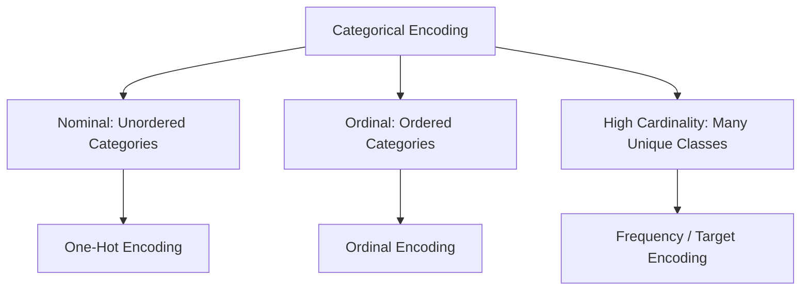

# 04.3. Categorical Feature Encoding and Text Normalization

## 1. Overview
Machine learning models require numerical input matrices. This note covers categorical encoding techniques (One-Hot, Ordinal, Frequency, Label), and text normalization: the cleaning pipeline, regex pattern cleaning, and accent transliteration with `unidecode`.

## 2. Categorical Encoding Schemes



### One-Hot Encoding (Nominal Features)
Creates a binary indicator column for each category. To avoid perfect multicollinearity (the **dummy variable trap**), drop one reference column by setting `drop_first=True`:

```python
import numpy as np
import pandas as pd

df = pd.DataFrame({
    "Gender": ["Female", "Male", "Male", "Female"],
    "City": ["Algiers", "Oran", "Algiers", "Annaba"],
    "Age": [25, 32, 47, 51],
})

# Avoid multicollinearity: drop_first=True
df_encoded = pd.get_dummies(df, columns=["Gender", "City"], drop_first=True, dtype=int)
print(df_encoded)
```

### Ordinal Encoding (Ranked Features)
Maps ordered categories to integers that preserve their natural rank:

```python
from sklearn.preprocessing import OrdinalEncoder

df["Education"] = ["Master", "High School", "PhD", "Bachelor"]

education_order = [["High School", "Bachelor", "Master", "PhD"]]
encoder = OrdinalEncoder(categories=education_order)
df["Education_Rank"] = encoder.fit_transform(df[["Education"]])
print(df[["Education", "Education_Rank"]])
```

### Frequency / Count Encoding (High-Cardinality Features)
Replaces categories with their overall frequency in the dataset, avoiding high-dimensional feature expansion:

```python
df["ZipCode"] = ["16000", "31000", "16000", "25000"]

freq_map = df["ZipCode"].value_counts(normalize=True).to_dict()
df["ZipCode_Freq"] = df["ZipCode"].map(freq_map)
print(df[["ZipCode", "ZipCode_Freq"]])
```

### Label Encoding (Target Column)
`sklearn`'s `LabelEncoder` compresses one column into integer codes `0..k-1`. Unlike `OrdinalEncoder` it is meant for a single column - the class labels of a supervised target - and carries the mapping for the way back:

```python
from sklearn.preprocessing import LabelEncoder

le = LabelEncoder()
diagnosis = pd.Series(["Diabetes", "Healthy", "Hypertension", "Diabetes", "Healthy"])
codes = le.fit_transform(diagnosis)
print("classes:", le.classes_.tolist())
print("codes  :", codes)
print("inverse:", le.inverse_transform(codes).tolist())
```

Using integer codes as a *feature* imposes a fake order (Healthy=1 is not "between" Diabetes=0 and Hypertension=2) - which is why the feature-side schemes above exist; the label side has no such problem because a classifier predicts codes, not distances between them.

## 3. Text Normalization Pipeline
Text columns often contain inconsistent casing and trailing whitespace. Normalize string features using the following pipeline:

```python
import numpy as np


def normalize_text_series(series: pd.Series) -> pd.Series:
    """Strips whitespace, converts to lowercase, and replaces null representations."""
    return series.astype(str).str.lower().str.strip().replace("none", np.nan)
```

## 4. Regex Text Cleaning
Beyond casing and whitespace, real string columns carry punctuation, doubled spaces and embedded numbers. The pandas string accessor takes regexes directly through `str.replace(..., regex=True)`, `str.extract` and `str.contains`:

```python
products = pd.Series([
    "  Wireless Mouse  ",
    "Keyboard (Mechanical)!!",
    "Monitor  27-inch",
    "USB hub v2.0",
])

cleaned = (products
    .str.lower()
    .str.replace(r"[^a-z0-9\s]", "", regex=True)   # drop punctuation
    .str.replace(r"\s+", " ", regex=True)          # collapse doubled spaces
    .str.strip())
print(cleaned.tolist())

versions = products.str.extract(r"v(\d+)\.(\d+)")   # capture groups -> new columns
print(versions)
```

`str.extract` returns one column per capture group with `NaN` where the pattern does not match - the same coerce-and-count pattern as numeric validation in [[04.2. Statistical Outlier Detection and Consistency Rectification]].

## 5. Accent Transliteration with unidecode
Names and cities written with accented characters (`Béjaïa`, `Zoë`) break exact matching and grouping. `unidecode` transliterates them to the closest plain-ASCII sequence:

```python
from unidecode import unidecode

cities = pd.Series(["Béjaïa", "Alger", "Oran", "Constantine", "Sétif"])
print([unidecode(c) for c in cities])   # ['Bejaia', 'Alger', 'Oran', 'Constantine', 'Setif']
```

> **Instructor PDF quirk (Chapter 5, p. 22).** The handout applies `unidecode` *after* a regex pass that already removed the accented characters - by then there is nothing left to transliterate and the step is a no-op. The working order is the reverse: `unidecode` first (`é -> e`, `ï -> i`), then regex cleaning on plain ASCII. Reproduce the handout as written when following it, but note the effective order.

```python
raw = pd.Series(["Sétif", "Béjaïa"])

# Handout order: regex first strips accents entirely, unidecode then sees nothing
regex_first = raw.str.replace(r"[^a-zA-Z]", "", regex=True).map(unidecode)
print("regex then unidecode:", regex_first.tolist())   # letters lost: ['Stif', 'Bjaa']

# Working order: unidecode first, regex on plain ASCII afterwards
unidecode_first = raw.map(unidecode).str.replace(r"[^a-zA-Z]", "", regex=True)
print("unidecode then regex:", unidecode_first.tolist())  # letters kept: ['Setif', 'Bejaia']
```

## 6. Connections to Other Topics
- Next step: [[04.4. Feature Scaling, Standardization, and Normalization Theory]].
- Applied in [[04.5. Tutorial 05 - End-to-End Medical Cohort Preprocessing Pipeline]].
- Type validation of the cleaned columns: [[04.2. Statistical Outlier Detection and Consistency Rectification]].

---
