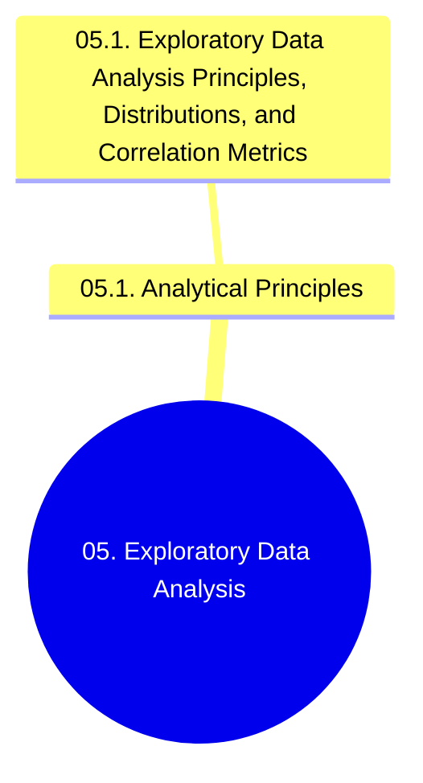

# 05. Exploratory Data Analysis - Chapter Overview and Navigation

## 1. Chapter Structure

## 2. Navigational Table of Contents

### 05.1. Analytical Principles
- [[05.1. Exploratory Data Analysis Principles, Distributions, and Correlation Metrics]]

## 3. Prerequisite Library Links
- Connects to foundations in [[00. Library Learning Roadmap]]

## 4. Stage Placement in the Unified Curriculum
This chapter closes **Stage 4 — Tabular engineering, preprocessing & EDA** ([[00. Master Curriculum Roadmap]] §3); its applied capstone is the iris project `APDS/09_Iris_Exploratory_Data_Analysis` (structure audit, Simpson-style twist, separability rules, pair grid).