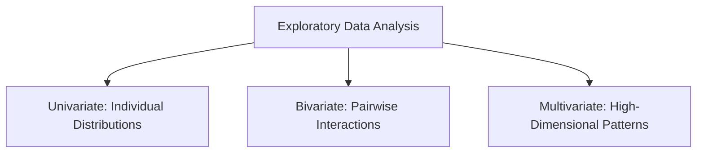
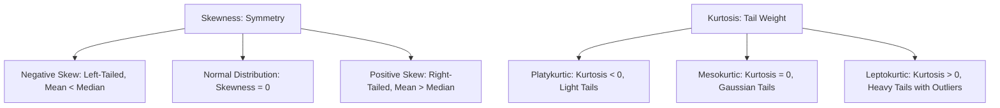

# 05.1. Exploratory Data Analysis Principles, Distributions, and Correlation Metrics

## 1. Overview
Exploratory Data Analysis (EDA) investigates dataset patterns, tests hypotheses, and checks statistical assumptions before formal modeling. This note is the complete Chapter 6 method summary: the three analysis lenses (univariate, bivariate, multivariate), categorical-categorical analysis through binning and contingency tables, multivariate views with pairplots and facets, skewness and kurtosis with their recommended actions, and the correlation coefficients in the instructor's covariance notation. The practical companion is the iris project notebook in the `APSD_TAI_LAB` repository (Section 7).

## 2. The Three Lenses: Univariate, Bivariate, Multivariate



- **Univariate Analysis**: Examines individual variables in isolation using histograms, KDE plots, and box plots for numeric features, and count plots for categorical features.
- **Bivariate Analysis**: Examines relationships between two features: numeric-numeric with scatter plots, numeric-categorical with grouped aggregations, and categorical-categorical with contingency tables (Section 3).
- **Multivariate Analysis**: Examines interactions across three or more variables simultaneously using pairplots, correlation heatmaps, and dimensional facets (Section 4).

## 3. Categorical-Categorical Analysis: Binning, Contingency Tables, Heatmaps

Two categorical columns are compared with a **contingency table** (`pd.crosstab`): rows for one category, columns for the other, cells counting the co-occurrences. A numeric column joins a categorical comparison by first being **binned into ordinal groups** with `pd.cut`. The table is then read visually as a heatmap.

```python
import pandas as pd
import seaborn as sns
import matplotlib.pyplot as plt

titanic = sns.load_dataset("titanic")

# Step 1 - bin the numeric age into ordinal age groups (numeric -> categorical)
titanic["AgeGroup"] = pd.cut(
    titanic["age"],
    bins=[0, 12, 18, 35, 60, 100],
    labels=["child", "teen", "young adult", "adult", "senior"],
)

# Step 2 - contingency table of age group vs passenger class (counts)
ct = pd.crosstab(titanic["AgeGroup"], titanic["class"])
print(ct)

# Step 3 - row-normalized proportions answer "where does each age group sit?"
print(pd.crosstab(titanic["AgeGroup"], titanic["class"], normalize="index").round(3))

# Step 4 - heatmap of the contingency table
sns.heatmap(ct, annot=True, fmt="d", cmap="YlGnBu")
plt.title("Passenger count by age group and class")
plt.show()
```

Reading rules: `normalize="index"` compares the *composition* of each row (age group), `normalize="columns"` the composition of each class, and no normalization the raw counts. On the Titanic table the first class over-represents adults and seniors while children concentrate in third class - a distributional fact a single bar chart cannot show.

## 4. Multivariate Views: Pairplot, FacetGrid, Grouped Bars

- **Pairplot** (`sns.pairplot`): draws every pairwise scatter plus the marginal distribution of each variable, one colour per category - the complete map of a numeric dataset.
- **FacetGrid** (`sns.FacetGrid`): splits the data into one panel per category value and maps the same plot into each panel, so a comparison is read positionally.
- **Grouped bar** (`sns.barplot`): aggregates a numeric column per category (mean by default) with the aggregation visible as bar height - the tabular companion of `groupby().agg()`.

```python
from sklearn.datasets import load_iris

bundle = load_iris()
iris = pd.DataFrame(bundle.data, columns=[
    "sepal_length", "sepal_width", "petal_length", "petal_width"])
iris["species"] = pd.Categorical.from_codes(bundle.target, bundle.target_names)

# Pairplot - every pairwise relationship, coloured by species
sns.pairplot(iris, hue="species")
plt.show()

# FacetGrid - one panel per species, same scatter inside each
g = sns.FacetGrid(iris, col="species")
g.map(sns.scatterplot, "petal_length", "petal_width")
plt.show()

# Grouped bar - mean petal length per species
sns.barplot(data=iris, x="species", y="petal_length", errorbar=None)
plt.show()
```

## 5. Distribution Moments: Skewness and Kurtosis



### Skewness
Measures the asymmetry of a distribution around its mean:
- **Positive Skew (Right-Tailed)**: The right tail is longer. The mean is typically greater than the median.
- **Negative Skew (Left-Tailed)**: The left tail is longer. The mean is typically less than the median.
- **Symmetric**: Skewness $\approx 0$.

### Kurtosis
Measures the "tailedness" of a distribution, indicating the frequency of extreme values (outliers):
- **Leptokurtic ($\text{Kurtosis} > 0$)**: Sharp peak and heavy tails, indicating a higher frequency of outliers.
- **Platykurtic ($\text{Kurtosis} < 0$)**: Flatter peak and thinner tails, indicating fewer extreme outliers.
- **Mesokurtic ($\text{Kurtosis} \approx 0$)**: Tailedness matches a normal distribution.

### Recommended-Actions Table

| Reading | Interpretation | Recommended action |
| :--- | :--- | :--- |
| Moderate positive skew (0.5 to 1) | Mild right tail | Report mean and median together; transform only for distance/gradient-based models |
| Strong positive skew (> 1) | Long right tail, mean pulled above median | Log or square-root transform; cap or investigate tail outliers first |
| Strong negative skew (< -1) | Long left tail | Check for floor/censoring effects; reflect-then-transform if a model needs symmetry |
| Leptokurtic (kurtosis > 0) | Heavy tails, frequent outliers | Expect outliers: detect with IQR or z-score, prefer median/IQR summaries |
| Platykurtic (kurtosis < 0) | Flat peak, thin tails | Check for rounding, truncation, or two mixed subpopulations |
| Near-zero skew and kurtosis | Approximately Gaussian | Parametric tools (z-score, Pearson correlation) are safe |

```python
# Reading the table on a real column: Titanic fare is the canonical example
print("fare skew:", titanic["fare"].skew().round(2),
      "| fare kurtosis:", titanic["fare"].kurt().round(2))
```

Titanic `fare` reads skew 4.79 and kurtosis 33.4 - strongly right-skewed and leptokurtic, so the table prescribes outlier inspection first and a log transform for any distance-based model. The same reading drives the scaling decision in the Titanic pipeline of [[04.6. Tutorial 05 - Titanic Predictive Modeling Pipeline and Classifier Evaluation]].

## 6. Correlation Coefficients

### Pearson Correlation ($r$) - the Instructor's Covariance Notation
Measures the strength and direction of a **linear** relationship between continuous variables. The instructor writes Pearson as covariance over the product of standard deviations:

$$r_{X,Y} = \frac{\text{Cov}(X, Y)}{\sigma_X \, \sigma_Y}, \qquad \text{Cov}(X, Y) = \frac{1}{n}\sum_{i=1}^{n}(x_i - \bar{x})(y_i - \bar{y})$$

The summation form below is the same formula expanded - divide numerator and denominator by $n$ (or $n-1$; the factor cancels) and the covariance and variances appear:

$$r = \frac{\sum (x_i - \bar{x})(y_i - \bar{y})}{\sqrt{\sum (x_i - \bar{x})^2 \sum (y_i - \bar{y})^2}}$$

- Value range: $[-1, 1]$.
- Assumes variables are normally distributed and linearly related. Sensitive to outliers.
- pandas: `df.corr()` returns the full Pearson matrix, `df.cov()` the covariance matrix.

```python
# The two notations are one identity: r = Cov(X, Y) / (sigma_X * sigma_Y)
x, y = iris["petal_length"], iris["petal_width"]
r_cov = x.cov(y) / (x.std() * y.std())
r_api = x.corr(y)
print(f"r via Cov/(sx*sy): {r_cov:.6f}")
print(f"r via .corr()    : {r_api:.6f}")
assert abs(r_cov - r_api) < 1e-12
```

### Spearman Rank Correlation ($\rho$)
A non-parametric metric that measures the **monotonic** relationship between two variables by comparing their ranked values:

$$\rho = 1 - \frac{6 \sum d_i^2}{n(n^2 - 1)}$$

- Robust to non-linearities and outliers.

### Kendall's Tau ($\tau$)
Measures rank correlation based on the number of concordant and discordant pairs:

$$\tau = \frac{\text{Concordant Pairs} - \text{Discordant Pairs}}{\frac{1}{2} n (n - 1)}$$

- Well-suited for small datasets with tied ranks.

## 7. From Principles to Practice: the Iris Project

Chapter 6 closes with a complete EDA project, implemented as a notebook in the `APSD_TAI_LAB` repository: `APDS/09_Iris_Exploratory_Data_Analysis/notebooks/01_iris_eda.ipynb` (output-free in the repository; run top to bottom to reproduce every figure). The notebook is this note's concepts applied in order:

| Notebook section | Concept from this note |
| :--- | :--- |
| 1 - Load and check structure | Univariate lens, structure audit |
| 2 - Per-species profiles | Grouped aggregation (mean petal length 1.46 cm setosa vs 5.55 cm virginica) |
| 4 - Correlation heatmap | Pearson matrix - and its pooling twist |
| 5 - The setosa rule | Bivariate reading: `petal_length < 2.5` separates setosa with zero errors |
| 6 - The petal scatter | Bivariate overlap: a 0.6 cm band where versicolor and virginica mix |
| 7 - Distribution comparison | Univariate distributions by group |
| 8 - Pair grid | Multivariate pairplot (Section 4) |
| 9 - Conclusions | Recommended actions on real readings |

The heatmap section carries the chapter's key multivariate lesson: pooled, the two sepal measurements are slightly *negatively* correlated (-0.12), but *within setosa alone* the correlation flips to +0.74 - each species sits in its own corner of the space, so the pooled line runs through the gaps between clusters, not through any within-species relation. Simpson's paradox is the standard name for this flip, and iris is its textbook example: pooled correlations are pooled artefacts, and the multivariate views (not any single number) are what reveal it.

## 8. Connections to Other Topics
- Visualized using heatmaps, pairplots, and facets in [[10. Matplotlib and Seaborn Statistical Plotting for Tabular Data]].
- Guides feature selection in [[04.6. Tutorial 05 - Titanic Predictive Modeling Pipeline and Classifier Evaluation]].
- The transformations this note prescribes (log, capping) are detailed in [[04.2. Statistical Outlier Detection and Consistency Rectification]].
- Missing-data views of a dataset before EDA: [[04.1. Missing Data Mechanisms and Statistical Imputation]].

---
