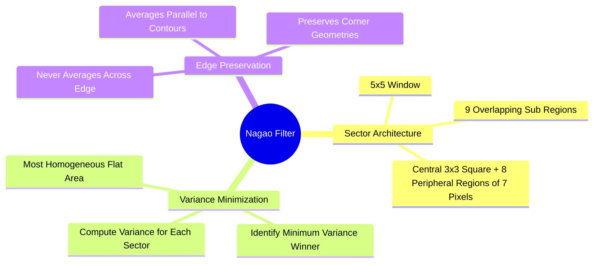

# Structural Edge-Preserving Smoothing: The Nagao Adaptive Multi-Sector Filter

Linear smoothing filters blur edges because they average pixels across boundaries. The **Nagao filter** avoids this by dividing the local neighborhood into oriented sub-regions and averaging only within the most homogeneous one. This note is the canonical concept treatment: the sub-region geometry (including the window sizing rules), the variance-minimization algorithm, and why edges survive it.



### 1. The Nine Sub-Regions (Canonical Definition)
The filter operates within a $5 \times 5$ window centered on pixel $P(x, y)$. The window is divided into **nine overlapping sub-regions**:
* **One central sub-region: the full $3 \times 3$ square centered on $P$ (9 pixels).**
* **Four cardinal bars** (N, S, E, W), 7 pixels each: $P$, the two pixels straight toward the cardinal direction, and their two lateral neighbors each.
* **Four corner quadrants** (NE, NW, SE, SW), 7 pixels each: $P$, the two pixels toward the corner, and the $2 \times 2$ block beyond them.

```text
R0 centre (9 px):          R1 north bar (7 px):       R5 NE quadrant (7 px):
  .  .  .  .  .              .  X  X  X  .              X  X  .  .  .
  .  X  X  X  .              .  X  X  X  .              X  X  X  .  .
  .  X [P] X  .              .  . [P] .  .              .  X [P] .  .
  .  X  X  X  .              .  .  .  .  .              .  .  .  .  .
  .  .  .  .  .              .  .  .  .  .              .  .  .  .  .
```

Every sub-region contains the center pixel, sub-regions overlap, and each peripheral region is a 7-pixel elongated neighborhood aligned with one of the 8 compass directions. On the $5 \times 5$ window this gives $9 + 8 \times 7 = 65$ pixel taps.

> **Course-wording note.** The course slide says "9 fenêtres de 7 pixels" — loose wording. The TP2 handout figure (p. 3 of `tp2_enonce_fr.pdf`: 8 peripheral 7-pixel regions + a $3 \times 3$ centre) and the canonical implementation `TAI/utils/filters.py:build_nagao_masks` agree: **8 peripheral regions of 7 pixels + a 3x3 square centre of 9 pixels**. The figure and the code are authoritative.

### 2. Window Sizing Rules
The filter generalizes to any odd window size $k \times k$ (radius $r = k/2$ rounded down); `build_nagao_masks` sizes the cliques as:

| Window | Centre clique | Cardinal bars | Diagonal quadrants | Total taps |
| :--- | :--- | :--- | :--- | :--- |
| $5 \times 5$ ($r=2$) | $3 \times 3$ (9 px) | 7 px each | 7 px each | 65 |
| $7 \times 7$ ($r=3$) | $3 \times 3$ (9 px) | 14 px each | 12 px each | 113 |
| $9 \times 9$ ($r=4$) | $5 \times 5$ (25 px) | 23 px each | 19 px each | 193 |

The centre stays $3 \times 3$ through $7 \times 7$ windows and grows to $5 \times 5$ from $9 \times 9$ (centre half-width $\lfloor r/2 \rfloor$); the bars widen with distance from the centre, the quadrants are the corner $r \times r$ blocks plus the centre and its two adjacent pixels.

### 3. Algorithmic Execution Steps
For each pixel $P(x, y)$ in the image:

**Step 1:** For each of the nine sub-regions $R_k \ (k = 0, \dots, 8)$, calculate the local mean $\mu_k$ and variance $\sigma_k^2$ over the $|R_k|$ member pixels ($|R_0| = 9$, $|R_k| = 7$ for the peripheral regions on the $5 \times 5$ window):

$$\mu_k = \frac{1}{|R_k|} \sum_{(i, j) \in R_k} f(i, j)$$

$$\sigma_k^2 = \frac{1}{|R_k|} \sum_{(i, j) \in R_k} \big( f(i, j) - \mu_k \big)^2 = \left( \frac{1}{|R_k|} \sum_{(i, j) \in R_k} f(i, j)^2 \right) - \mu_k^2$$

**Step 2:** Find the sub-region with the **lowest variance**:

$$k^* = \arg\min_{k \in \{0, \dots, 8\}} \Big( \sigma_k^2 \Big)$$

**Step 3:** Assign the mean of this winning sub-region to the output pixel:

$$g(x, y) = \mu_{k^*}$$

### 4. Why the Nagao Filter Preserves Edges
Variance measures local intensity dispersion:
* A sub-region that crosses an edge contains pixels from both sides of the boundary, resulting in a large variance $\sigma^2$.
* A sub-region that lies entirely on one side of an edge contains pixels of similar intensities, resulting in a small variance $\sigma^2$.

Because the filter selects the sub-region with the lowest variance, it always averages pixels that lie on the **same side of the edge as the center pixel**, smoothing noise without blurring across the boundary.

### 5. Canonical Implementation
The lab repository implements this filter as `TAI/utils/filters.py` (`build_nagao_masks` + `filtreNagao`) — that module is the single source of truth for the geometry and the vectorized execution. The TP2 laboratory walkthrough embeds it: [[09.5. TP2 Part 2 - Edge-Preserving Non-Linear Smoothing with Nagao Filter]]. Four further cross-verified implementation variants (explicit loops, semi-vectorized gathering, hardcoded-kernel convolution, stride-tricks sliding windows) with measured benchmarks and border-mode pitfalls are in [[26. Nagao Filtering - Multi-Implementation Reference with Hardcoded Kernels, Vectorized, and Convolution Approaches]]; the exam-defense companion with the offset sets ready to transcribe is [[26.5. Nagao Filtering - 9-Sector Geometry, Kernels & Variance Clamping]].

Related concepts: [[02. NumPy Array Manipulation - Slicing, Strides, Shapes, and Vectorized Indexing]], [[02.3. Linear Spatial Smoothing (Mean Box Filter, Gaussian Bell, and 1D Separability)]], [[09.5. TP2 Part 2 - Edge-Preserving Non-Linear Smoothing with Nagao Filter]].

---
