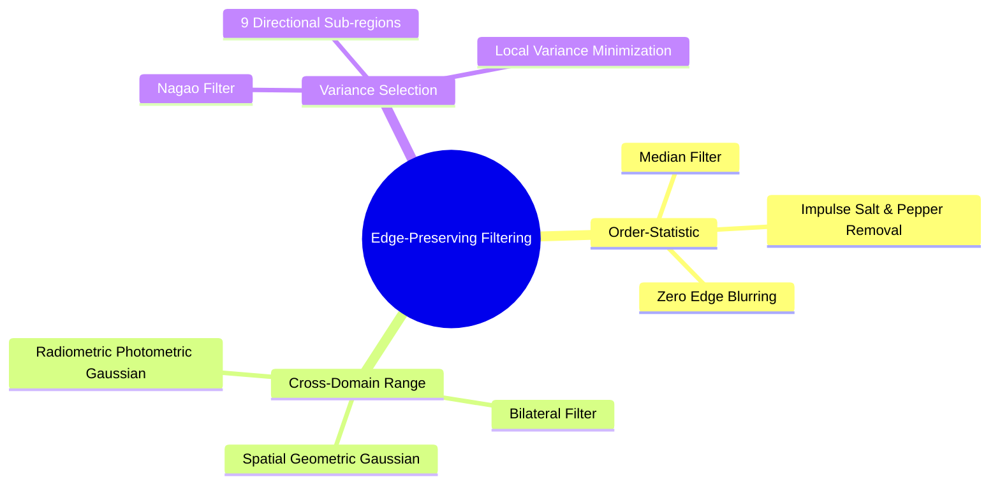

# 20. Non-Linear and Edge-Preserving Filtering - Median, Bilateral, and Nagao Filters

## 1. Overview
Linear filtering blurs sharp boundaries because it computes an unweighted average of neighboring pixels across edges. Non-linear edge-preserving filters solve this by adapting smoothing to local edge orientations and radiometric differences. This note covers Median filtering, Bilateral filtering, and the directional Nagao filter.



## 2. The Median Filter (`cv2.medianBlur`)
The median filter is an order-statistic filter that replaces each pixel with the statistical median of its neighborhood $W$:

$$I_{\text{median}}(y, x) = \text{median}\Big\{ I(y + i, \ x + j) \mid (i, j) \in W \Big\}$$

### Why the Median Filter Outperforms Mean Filters on Impulse Noise
- **Mean Filter**: Incorporates corrupted values ($0$ or $255$) directly into the average, pulling the result away from the true intensity:
  $$\text{Mean}([120, 122, 121, 123, 255]) = 148.2 \quad (\text{Distorted})$$
- **Median Filter**: Discards extreme outliers during rank sorting, preserving the underlying value:
  $$\text{Median}(\text{sort}([120, 121, 122, 123, 255])) = 122 \quad (\text{Accurate})$$

## 3. The Bilateral Filter (`cv2.bilateralFilter`)
The bilateral filter combines spatial geometric proximity with radiometric intensity similarity:

$$I_{\text{bilateral}}(p) = \frac{1}{W_p} \sum_{q \in S} I(q) \cdot G_{\sigma_s}(\|p - q\|) \cdot G_{\sigma_r}(|I(p) - I(q)|)$$

Where:
- $p = (y, x)$ is the target center pixel coordinate.
- $q = (y', x')$ is an adjacent neighborhood pixel coordinate.
- $G_{\sigma_s}(\|p - q\|) = \exp\left(-\frac{\|p - q\|^2}{2\sigma_s^2}\right)$ is the **spatial Gaussian kernel**, which weights pixels by geometric distance.
- $G_{\sigma_r}(|I(p) - I(q)|) = \exp\left(-\frac{|I(p) - I(q)|^2}{2\sigma_r^2}\right)$ is the **radiometric Gaussian kernel**, which weights pixels by intensity similarity.
- $W_p = \sum_{q \in S} G_{\sigma_s}(\|p - q\|) \cdot G_{\sigma_r}(|I(p) - I(q)|)$ is a normalization factor.

When the filter encounters a high-contrast boundary, pixels on the opposite side of the edge have large intensity differences $|I(p) - I(q)|$. This drives their radiometric weight $G_{\sigma_r}$ toward zero, preventing smoothing across the edge.

> **Deep dive:** the complete treatment — worked numeric examples, parameter limits, from-scratch NumPy and OpenCV implementations, the range-LUT optimization, complexity analysis, artifacts (staircasing, gradient reversal), and applications — is in [[25. Bilateral Filtering - Complete Mathematical Theory, Implementation, and Practice]].

## 4. The Nagao Filter

The Nagao filter is an edge-preserving operator that analyzes a $5 \times 5$ window around each pixel, partitioned into 9 overlapping directional sub-regions — the central $3 \times 3$ square, four cardinal bars, and four corner quadrants — and replaces the pixel with the mean of the lowest-variance sub-region. Variance is high across an edge and low within homogeneous regions, so the filter smooths noise while keeping edges sharp: it averages **along** contours, never across them.

> **Canonical treatment** (single source of truth; the geometry, sizing rules, and statistics are not repeated here): concept note [[02.6. Structural Edge-Preserving Smoothing (Nagao 9-Sector Multi-Directional Filter)]] · TP2 laboratory walkthrough with the canonical `TAI/utils/filters.py` implementation [[09.5. TP2 Part 2 - Edge-Preserving Non-Linear Smoothing with Nagao Filter]] · multi-implementation engineering reference [[26. Nagao Filtering - Multi-Implementation Reference with Hardcoded Kernels, Vectorized, and Convolution Approaches]] · exam companion [[26.5. Nagao Filtering - 9-Sector Geometry, Kernels & Variance Clamping]].

## 5. Code Implementation Examples

The two library-shipped members of the family are one-liners; Nagao ships in no major library and is implemented once, canonically, in the lab repository:

```python
import cv2
import numpy as np

noisy = np.random.default_rng(0).integers(0, 256, (16, 16), dtype=np.uint8)

denoised_median = cv2.medianBlur(noisy, 5)                # int ksize (odd)
denoised_bilateral = cv2.bilateralFilter(noisy, 9, 75, 75)  # (d, sigmaColor, sigmaSpace)
print(denoised_median.shape, denoised_bilateral.shape)
# Nagao: no cv2.nagao() - the canonical implementation is
# TAI/utils/filters.py:filtreNagao, embedded in
# [[09.5. TP2 Part 2 - Edge-Preserving Non-Linear Smoothing with Nagao Filter]]
```

## 6. Connections to Other Topics
- Theoretical comparison with linear smoothing in [[19. Spatial Image Restoration - Noise Models, Linear Convolution, and Fast Integral Filters]].
- Quantitative assessment in [[22. Objective Image Quality Assessment - MSE, PSNR, and SSIM Metrics]].
- Evaluated on test benchmarks in [[09.5. TP2 Part 2 - Edge-Preserving Non-Linear Smoothing with Nagao Filter]].
- Bilateral deep dive: [[25. Bilateral Filtering - Complete Mathematical Theory, Implementation, and Practice]].
- Nagao deep dive: [[26. Nagao Filtering - Multi-Implementation Reference with Hardcoded Kernels, Vectorized, and Convolution Approaches]].

---
