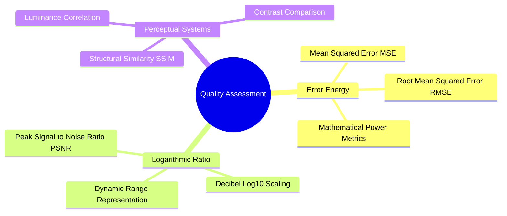
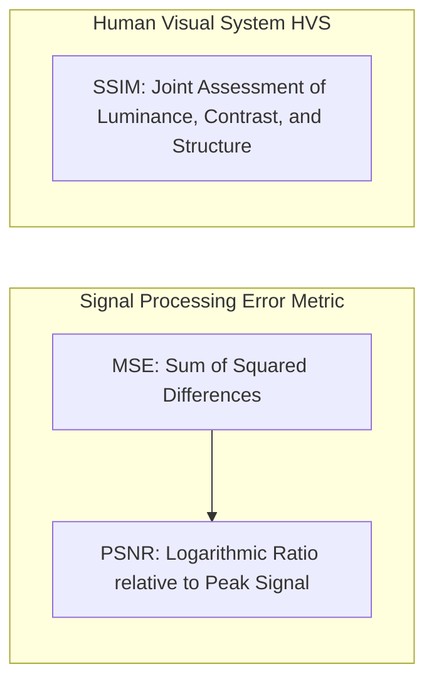

# 22. Objective Image Quality Assessment - MSE, PSNR, and SSIM Metrics

## 1. Overview
Objective image quality metrics provide quantitative benchmarks to assess fidelity after restoration, filtering, or super-resolution. This note covers Mean Squared Error (MSE), Peak Signal-to-Noise Ratio (PSNR), and the Structural Similarity Index (SSIM).



## 2. Mathematical Formulations



### 2.1 Mean Squared Error (MSE)
Calculates the average squared difference between an original reference image $I$ and a modified or degraded image $\hat{I}$, across dimensions $H \times W$:

$$\text{MSE} = \frac{1}{H \cdot W} \sum_{y=0}^{H-1} \sum_{x=0}^{W-1} \Big( I(y, x) - \hat{I}(y, x) \Big)^2$$

- **Ideal Value**: $0$ indicates identical images.
- **Limitation**: Sensitive to global brightness offsets that may not significantly impact perceived visual quality.

### 2.2 Peak Signal-to-Noise Ratio (PSNR)
Expresses reconstruction fidelity on a logarithmic decibel (dB) scale, comparing maximum possible signal power to the error power:

$$\text{PSNR} = 10 \cdot \log_{10} \left( \frac{R^2}{\text{MSE}} \right)$$

Where $R$ is the dynamic range of the image data type:
- For 8-bit unsigned integers (`uint8`), $R = 2^{8} - 1 = 255$.
- For normalized floating-point images (`float64`), $R = 1.0$.

$$\text{PSNR} = 10 \cdot \log_{10} \left( \frac{255^2}{\text{MSE}} \right) = 20 \cdot \log_{10}(255) - 10 \cdot \log_{10}(\text{MSE}) \approx 48.13 - 10 \cdot \log_{10}(\text{MSE})$$

- If $\text{MSE} \to 0$, $\text{PSNR} \to \infty$ (identical signals).
- Typical reconstruction values: $30\text{--}45\text{ dB}$ for high-quality restoration; $<20\text{ dB}$ for severely corrupted rasters.

### 2.3 Structural Similarity Index (SSIM)
While PSNR measures raw numerical error, SSIM evaluates image degradation based on three perceived visual components: **luminance** ($l$), **contrast** ($c$), and **structural correlation** ($s$):

$$\text{SSIM}(x, y) = \Big[ l(x, y) \Big]^\alpha \cdot \Big[ c(x, y) \Big]^\beta \cdot \Big[ s(x, y) \Big]^\gamma$$

Setting exponents $\alpha = \beta = \gamma = 1$ yields the standard form:

$$\text{SSIM}(x, y) = \frac{(2\mu_x\mu_y + C_1)(2\sigma_{xy} + C_2)}{(\mu_x^2 + \mu_y^2 + C_1)(\sigma_x^2 + \sigma_y^2 + C_2)}$$

Where:
- $\mu_x, \mu_y$: Local mean intensities.
- $\sigma_x^2, \sigma_y^2$: Local sample variances.
- $\sigma_{xy}$: Cross-covariance between signals $x$ and $y$.
- $C_1 = (K_1 R)^2, \ C_2 = (K_2 R)^2$: Regularization constants (typically $K_1 = 0.01, \ K_2 = 0.03$) preventing division by zero when denominators are near zero.

**Windowing (Wang et al., 2004).** The statistics above are *local*: they are
computed in an $11 \times 11$ Gaussian-weighted window with $\sigma = 1.5$,
slid over the whole image; the final score is the mean of the per-window SSIM
map. This is exactly the reference implementation in
`APSD_TAI_LAB/TAI/utils/metrics.py::calculate_ssim` — for colour images the
SSIM is averaged channel-wise over B, G, R, and $R$ (the data range, $L$) is a
parameter (`data_range=255.0` for `uint8`). A single *global* computation
(whole-image mean/variance plugged into the same formula) is a common exam
shortcut, but it is **not** SSIM: it discards the locality that makes the
metric perceptual.

## 3. Python Implementations

The canonical implementations live in `APSD_TAI_LAB/TAI/utils/metrics.py`
(`calculate_psnr`, `calculate_ssim`) — every TAI lab imports them from there.
The versions below reproduce that module exactly, so the exam handwriting and
the lab code can never diverge.

```python
import math

import cv2
import numpy as np


def calculate_mse(original: np.ndarray, distorted: np.ndarray) -> float:
    """Computes Mean Squared Error between two matrices."""
    if original.shape != distorted.shape:
        raise ValueError("Image matrices must have identical dimensions.")
    diff = original.astype(np.float64) - distorted.astype(np.float64)
    return float(np.mean(diff ** 2))


def calculate_psnr(original: np.ndarray, distorted: np.ndarray,
                   data_range: float = 255.0) -> float:
    """Peak Signal-to-Noise Ratio in decibels.

    PSNR = 10 * log10(data_range^2 / MSE). Returns float('inf') for
    identical inputs (MSE == 0) and matches cv2.PSNR for finite values.
    """
    orig = np.asarray(original, dtype=np.float64)
    deg = np.asarray(distorted, dtype=np.float64)
    if orig.shape != deg.shape:
        raise ValueError("Image shapes differ — PSNR undefined.")
    mse = float(np.mean((orig - deg) ** 2))
    if mse == 0.0:
        return float("inf")
    return 10.0 * math.log10((data_range ** 2) / mse)


def _ssim_gray(img1: np.ndarray, img2: np.ndarray, data_range: float) -> float:
    """SSIM between two single-channel images (Wang et al. 2004)."""
    a = img1.astype(np.float64)
    b = img2.astype(np.float64)
    c1 = (0.01 * data_range) ** 2
    c2 = (0.03 * data_range) ** 2

    mu1 = cv2.GaussianBlur(a, (11, 11), 1.5)
    mu2 = cv2.GaussianBlur(b, (11, 11), 1.5)
    mu1_sq, mu2_sq, mu1_mu2 = mu1 * mu1, mu2 * mu2, mu1 * mu2
    s1_sq = cv2.GaussianBlur(a * a, (11, 11), 1.5) - mu1_sq
    s2_sq = cv2.GaussianBlur(b * b, (11, 11), 1.5) - mu2_sq
    s12 = cv2.GaussianBlur(a * b, (11, 11), 1.5) - mu1_mu2

    num = (2.0 * mu1_mu2 + c1) * (2.0 * s12 + c2)
    den = (mu1_sq + mu2_sq + c1) * (s1_sq + s2_sq + c2)
    return float(np.mean(num / den))


def calculate_ssim(img1: np.ndarray, img2: np.ndarray,
                   data_range: float = 255.0) -> float:
    """Structural Similarity Index (Wang et al. 2004), no external dependency.

    Local statistics come from the 11x11 Gaussian window (sigma = 1.5); for
    colour images the SSIM is averaged over the B, G, R channels. Returns 1.0
    for identical inputs.
    """
    a = np.asarray(img1)
    b = np.asarray(img2)
    if a.shape != b.shape:
        raise ValueError("Image shapes differ — SSIM undefined.")
    if a.ndim == 3:
        return float(np.mean([
            _ssim_gray(a[:, :, c], b[:, :, c], data_range)
            for c in range(a.shape[2])
        ]))
    return _ssim_gray(a, b, data_range)
```

Note the three lab conventions baked into these signatures: the `inf`
PSNR for perfect reconstruction (detect with `math.isinf`), the
`data_range` parameter instead of a hard-coded 255, and the zero-dependency
Gaussian-windowed SSIM (identical inputs return exactly 1.0).

## 4. Connections to Other Topics
- **Canonical implementation:** `APSD_TAI_LAB/TAI/utils/metrics.py` — the module every TAI notebook imports (`from TAI.utils.metrics import calculate_psnr, calculate_ssim`); the repo-wide convention is `float("inf")` PSNR for identical images, documented in the module docstring.
- Used to benchmark restoration filters in [[19. Spatial Image Restoration - Noise Models, Linear Convolution, and Fast Integral Filters]].
- Applied to evaluate super-resolution algorithms in [[24. Super-Resolution and Edge-Adaptive Interpolation - Pascal Getreuer Contour Stencils]] and [[09.8. TP2 Part 5 - Single-Frame Super-Resolution and Contour Stencils]].
- The exam-defense companion [[22.5. Objective Metrics - MSE, PSNR, SSIM & Zero-Division Defense]] drills the same signatures.

---
