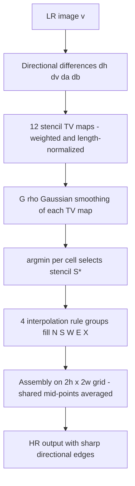

# 24. Super-Resolution and Edge-Adaptive Interpolation - Pascal Getreuer Contour Stencils

> Deep-dive library reference for contour-stencil super-resolution. The canonical implementation is `super_resolution_contour_stencils_2x` in `APSD_TAI_LAB/TAI/utils/super_res.py` (12 oriented stencils, output exactly `(2h, 2w)`, YCrCb ℓ1 colour norm, `G_ρ` smoothing) — the one executed by the TP2 lab notebook `TAI/04_TP2_Super_Resolution`; the lab walkthrough lives in [[09.8. TP2 Part 5 - Single-Frame Super-Resolution and Contour Stencils]] and the exam companion in [[24.5. Super-Resolution - Contour Stencils & Sub-Pixel Interpolation]]. Sources: P. Getreuer, *Contour stencils for edge-adaptive image interpolation*, Proc. SPIE vol. 7257, 2009 (`TAI/docs/references/getreuer_2009_contour_stencils.pdf`) and `tp2_enonce_fr.pdf` Exercise 6.

## 1. Overview and Problem Formulation

Single-frame super-resolution reconstructs a high-resolution (HR) image from a low-resolution (LR) input. Standard linear interpolation (bilinear, bicubic) applies the same averaging weights everywhere, so a 2-pixel-wide edge in the LR grid becomes a blurry ramp in the HR grid — interpolating **across** an edge mixes both of its populations. Pascal Getreuer's (2009) **contour stencils** algorithm instead estimates, for every LR cell, the local edge orientation, and interpolates **along** the estimated contour — producing sharp, ringing-free edges without the stair-casing of nearest-neighbour.



The algorithm answers two separate questions per cell:

1. **Detection** — which of the 12 candidate orientations best explains the local contour? (minimum weighted total variation)
2. **Interpolation** — where do the missing sub-pixel samples go, given that orientation? (rule groups over the cell corners)

## 2. Mathematical Foundations: Total Variation Along Curves

For a smooth candidate curve $C$ parameterized by $\gamma(t)$, $t \in [0, T]$, the total variation of the image $u$ along $C$ is:

$$\text{TV}(C) = \int_{0}^{T} \left| \frac{\partial}{\partial t} u(\gamma(t)) \right| dt$$

If $\text{TV}(C) \approx 0$, intensity is nearly constant along the curve — the curve follows an image contour.

### 2.1 Error Bound Theorem (Getreuer, Theorem 3.1)

Approximating $u(x)$ along a curve segment through nodes $a, x, b$ with a convex combination:

$$\hat{u}(x) = (1 - \lambda)\, u(a) + \lambda\, u(b), \qquad 0 \le \lambda \le 1$$

the error is bounded by the curve's total variation:

$$|\hat{u}(x) - u(x)| \le \max\big(|1 - \lambda|, |\lambda|\big) \cdot \text{TV}(C)$$

**Core insight:** selecting the candidate curve with the smallest $\text{TV}(C)$ directly minimizes the *upper bound* on the interpolation error. Interpolation along a near-zero-TV contour is nearly exact even at the edge itself.

## 3. Discrete Contour Stencils

Let $v_{i,j}$ denote pixel $(i, j)$. The **cell** $(i, j)$ is the square whose corners are $v_{i,j}$, $v_{i+1,j}$, $v_{i,j+1}$, $v_{i+1,j+1}$. A curve discretized as a pixel sequence $\alpha_0, \ldots, \alpha_N$ has:

$$\text{TV}(C) \approx \sum_{n=1}^{N} \big| v(\alpha_n) - v(\alpha_{n-1}) \big|$$

Because nearby parallel curves have approximately the same TV, the estimate is improved by **averaging several parallel curves**: a *contour stencil* $S$ is a set of edges between pixels approximating parallel curves over a small patch. Its TV at cell $(i, j)$ is the weighted, length-normalized sum:

$$\text{TV}_{i,j}(S) = \frac{1}{|S|} \sum_{\text{edges}} w_{\alpha,\beta}\, \big| v_\alpha - v_\beta \big|, \qquad |S| = \sum_{\text{edges}} w_{\alpha,\beta}\, \|x_\alpha - x_\beta\|$$

The paper's Figure 1 example (a 45° stencil of 5 edges: two diagonal pairs of weight 1, four anti-diagonal edges of weight ¼, all over the cell):

$$\text{TV}_{i,j}(S) = \frac{|v_{i,j} - v_{i-1,j+1}| + |v_{i,j} - v_{i+1,j-1}| + \tfrac{1}{4}\big(4 \cdot |v_{i,j+1} - v_{i+1,j}|\big) + |v_{i+1,j+1} - v_{i,j+2}| + |v_{i+1,j+1} - v_{i+2,j}|}{(1+1+4+1+1)\sqrt{2}}$$

### 3.1 The 12-Stencil Set (paper Figure 2)

The proposed set $\Sigma$ contains **12 stencils that together distinguish 8 orientations**:

| # | Orientation | Edges used |
| :--- | :--- | :--- |
| 0 | vertical `\|` | three vertical differences in each of two adjacent columns |
| 1 | horizontal `—` | three horizontal differences in each of two adjacent rows |
| 2 | anti-diagonal `/` (45°) | five anti-diagonal differences |
| 3 | main diagonal `\` (−45°) | five main-diagonal differences |
| 4, 7 | gentle `/` ≈ 26.6° and steep `/` ≈ 63.4° | mixes of anti-diagonal + horizontal/vertical differences |
| 5, 6 | gentle `\` ≈ −26.6° and steep `\` ≈ −63.4° | mixes of main-diagonal + horizontal/vertical differences |
| 8, 9 | mixed `/-H-/`, `\-H-\` | anti/main diagonal flanks + horizontal core |
| 10, 11 | mixed `\-V-\`, `/-V-/` | anti/main diagonal flanks + vertical core |

The best-fitting stencil per cell is the TV minimizer:

$$S^*_{i,j} = \arg\min_{S \in \Sigma} \text{TV}_{i,j}(S)$$

**Two refinements from the paper, both implemented in `TAI/utils/super_res.py`:**

- **Remark 1 (noise robustness):** the TV maps are spatially filtered by a Gaussian $G_\rho$ — $\text{TV}^\rho_{i,j}(S) = (G_\rho * \text{TV}(S))_{i,j}$ — before the `argmin`. Light filtering improves detection even on clean images (default `rho = 0.5`).
- **Remark 3 (colour):** the absolute value is replaced by a vector norm in a colour space; the lab uses the $\ell_1$ norm of the **YCrCb** difference vector: $\|u - w\| = |u_Y - w_Y| + |u_{Cr} - w_{Cr}| + |u_{Cb} - w_{Cb}|$.

## 4. Interpolation: the Four Rule Groups (paper §3.2)

The LR cell corners are $v_{i,j}$ (top-left), $v_{i+1,j}$ (bottom-left), $v_{i,j+1}$ (top-right), $v_{i+1,j+1}$ (bottom-right); the missing sub-pixels are the four **edge mid-points** $N, S, W, E$ and the **cell centre** $X$. In the paper's diagrams, open circles are computed as the average of all incoming arrows. Four rule groups cover the 12 stencils:

```text
        v(i,j) -------- N -------- v(i,j+1)
          |                         |
          W            X            E
          |                         |
       v(i+1,j) ------ S ------ v(i+1,j+1)
```

**Group A — bilinear fallback** (vertical stencil 0, horizontal stencil 1, and any orientation whose rules do not touch a given sample):

$$N = \tfrac{1}{2}(v_{i,j} + v_{i,j+1}), \quad S = \tfrac{1}{2}(v_{i+1,j} + v_{i+1,j+1}), \quad W = \tfrac{1}{2}(v_{i,j} + v_{i+1,j}), \quad E = \tfrac{1}{2}(v_{i+1,j} + v_{i+1,j+1})$$
$$X = \tfrac{1}{4}(v_{i,j} + v_{i+1,j} + v_{i,j+1} + v_{i+1,j+1})$$

**Group B — pure diagonals** (stencils 2 `/` and 3 `\`): only the centre changes, to the diagonal average —
$X = \tfrac{1}{2}(v_{i+1,j} + v_{i,j+1})$ for `/`; $X = \tfrac{1}{2}(v_{i,j} + v_{i+1,j+1})$ for `\`.

**Group C — steep orientations** (4–7): the two mid-points *crossed by* the contour and the centre all take the diagonal average. For the gentle `/` (4): $W = E = X = \tfrac{1}{2}(v_{i+1,j} + v_{i,j+1})$; for the steep `\` (5): $N = S = X = \tfrac{1}{2}(v_{i,j} + v_{i+1,j+1})$; mirrored for 6 and 7.

**Group D — mixed orientations** (8–11): one mid-point swaps to the mid-point value of the *other* axis. For 8 (`/-H-/`): $W = N$-value, $E = S$-value; for 10 (`\-V-\`): $N = E$-value, $S = W$-value; mirrored for 9 and 11.

### 4.1 Assembly on the `(2h, 2w)` Grid

The output grid is exactly **`(2h, 2w)`** — double the LR height and width, with the LR sample $v_{i,j}$ sitting at HR coordinates $(2i, 2j)$ and the cell centre $X$ at $(2i+1, 2j+1)$. Mid-points are **shared** between adjacent cells and averaged at assembly: the horizontal mid-point between cells $(i, j)$ and $(i, j+1)$ becomes $\tfrac{1}{2}(E_{i,j} + W_{i,j+1})$; the vertical mid-point between rows becomes $\tfrac{1}{2}(S_{i,j} + N_{i+1,j})$. The last row/column (beyond the last cells) is filled by edge extrapolation — duplicating the previous row/column — which is why the output is `(2h, 2w)` and **not** the `(2h−1, 2w−1)` one would get by only filling between original samples.

For factor 4 the paper recommends **pyramid magnification**: apply the 2× operator twice, re-estimating the orientations on the intermediate image (each pass costs only the intermediate size). The lab's 4× comparison in [[09.8. TP2 Part 5 - Single-Frame Super-Resolution and Contour Stencils]] follows exactly this cascade.

## 5. Canonical Implementation (`TAI/utils/super_res.py`)

The lab module `super_resolution_contour_stencils_2x(image, rho=0.5)` is fully vectorized. The compressed pipeline below reproduces its four stages — directional differences, 12 weighted TV maps with `G_ρ` smoothing, `argmin` detection, rule groups + assembly — on a grayscale image, and matches the canonical module bit-for-bit when `rho` is equal (verified for `rho=0.0` on random and synthetic images; `rho=0.5` differs only because the module smooths in YCrCb for colour inputs):

```python
import math

import cv2
import numpy as np


def stencil_interpolation_2x(image, rho=0.0):
    """Compressed reproduction of TAI/utils/super_res.py (grayscale path).

    Same stages as the canonical module: 12 weighted TV maps, optional
    Gaussian smoothing G_rho, per-cell argmin, 4 rule groups, assembly on
    the (2h, 2w) grid with shared mid-point averaging.
    """
    h, w = image.shape[:2]
    img_f = image.astype(np.float64)
    pad = np.pad(img_f, ((1, 1), (1, 1)), mode="edge")

    # Stage 1: directional differences on the padded grid
    dh = np.abs(pad[:, :-1] - pad[:, 1:])       # horizontal
    dv = np.abs(pad[:-1, :] - pad[1:, :])       # vertical
    da = np.abs(pad[:-1, :-1] - pad[1:, 1:])    # main diagonal
    db = np.abs(pad[1:, :-1] - pad[:-1, 1:])    # anti-diagonal

    ch, cw = h - 1, w - 1
    diff = {"dh": dh, "dv": dv, "da": da, "db": db}
    s2 = math.sqrt(2.0)

    # Stage 2: the 12 stencils as (edge list, normalizing length)
    stencils = [
        ([("dv", 0, 1, 22), ("dv", 1, 1, 43), ("dv", 2, 1, 22),
          ("dv", 0, 2, 22), ("dv", 1, 2, 43), ("dv", 2, 2, 22)], 174.0),
        ([("dh", 1, 0, 22), ("dh", 1, 1, 43), ("dh", 1, 2, 22),
          ("dh", 2, 0, 22), ("dh", 2, 1, 43), ("dh", 2, 2, 22)], 174.0),
        ([("db", 1, 0, 16), ("db", 0, 1, 16), ("db", 1, 1, 59),
          ("db", 2, 1, 16), ("db", 1, 2, 16)], 123.0 * s2),
        ([("da", 1, 2, 16), ("da", 0, 1, 16), ("da", 1, 1, 59),
          ("da", 2, 1, 16), ("da", 1, 0, 16)], 123.0 * s2),
        ([("db", 0, 0, 17), ("dh", 0, 1, 22), ("dh", 2, 0, 17),
          ("db", 1, 1, 34), ("dh", 1, 2, 17), ("dh", 3, 1, 22),
          ("db", 2, 2, 17)], 78.0 + 68.0 * s2),
        ([("da", 0, 2, 17), ("dv", 1, 3, 22), ("dv", 0, 1, 17),
          ("da", 1, 1, 34), ("dv", 2, 2, 17), ("dv", 1, 0, 22),
          ("da", 2, 0, 17)], 78.0 + 68.0 * s2),
        ([("dh", 0, 1, 22), ("da", 0, 2, 17), ("dh", 1, 0, 17),
          ("da", 1, 1, 34), ("dh", 2, 2, 17), ("da", 2, 0, 17),
          ("dh", 3, 1, 22)], 78.0 + 68.0 * s2),
        ([("db", 0, 0, 17), ("dv", 1, 0, 22), ("dv", 0, 2, 17),
          ("db", 1, 1, 34), ("dv", 2, 1, 17), ("dv", 1, 3, 22),
          ("db", 2, 2, 17)], 78.0 + 68.0 * s2),
        ([("db", 1, 0, 34), ("dh", 1, 1, 39), ("dh", 2, 1, 39),
          ("db", 1, 2, 34)], 78.0 + 68.0 * s2),
        ([("da", 1, 0, 34), ("dh", 1, 1, 39), ("dh", 2, 1, 39),
          ("da", 1, 2, 34)], 78.0 + 68.0 * s2),
        ([("da", 0, 1, 34), ("dv", 1, 1, 39), ("dv", 1, 2, 39),
          ("da", 2, 1, 34)], 78.0 + 68.0 * s2),
        ([("db", 0, 1, 34), ("dv", 1, 1, 39), ("dv", 1, 2, 39),
          ("db", 2, 1, 34)], 78.0 + 68.0 * s2),
    ]

    tv_maps = np.empty((12, ch, cw), dtype=np.float64)
    for idx, (edges, norm_len) in enumerate(stencils):
        acc = np.zeros((ch, cw), dtype=np.float64)
        for dkey, r0, c0, weight in edges:
            acc += weight * diff[dkey][r0:r0 + ch, c0:c0 + cw]
        tv_map = acc / norm_len
        if rho > 0.0:
            tv_map = cv2.GaussianBlur(tv_map, (3, 3), sigmaX=rho,
                                      borderType=cv2.BORDER_REFLECT)
        tv_maps[idx] = tv_map

    best = np.argmin(tv_maps, axis=0)   # Stage 3: detection

    # Stage 4: rule groups on the cell corners
    tl, tr = img_f[:-1, :-1], img_f[:-1, 1:]
    bl, br = img_f[1:, :-1], img_f[1:, 1:]
    mid_n, mid_s = 0.5 * (tl + tr), 0.5 * (bl + br)
    mid_w, mid_e = 0.5 * (tl + bl), 0.5 * (tr + br)
    avg4 = 0.25 * (tl + tr + bl + br)
    diag_anti, diag_main = 0.5 * (bl + tr), 0.5 * (tl + br)

    n_val, s_val = mid_n.copy(), mid_s.copy()
    w_val, e_val = mid_w.copy(), mid_e.copy()
    x_val = avg4.copy()

    x_val[best == 2] = diag_anti[best == 2]     # Group B
    x_val[best == 3] = diag_main[best == 3]
    m = best == 4                                # Group C
    w_val[m] = e_val[m] = x_val[m] = diag_anti[m]
    m = best == 5
    n_val[m] = s_val[m] = x_val[m] = diag_main[m]
    m = best == 6
    w_val[m] = e_val[m] = x_val[m] = diag_main[m]
    m = best == 7
    n_val[m] = s_val[m] = x_val[m] = diag_anti[m]
    m = best == 8                                # Group D
    w_val[m], e_val[m] = mid_n[m], mid_s[m]
    m = best == 9
    e_val[m], w_val[m] = mid_n[m], mid_s[m]
    m = best == 10
    n_val[m], s_val[m] = mid_e[m], mid_w[m]
    m = best == 11
    n_val[m], s_val[m] = mid_w[m], mid_e[m]

    # Assembly on (2h, 2w); shared mid-points averaged
    out = np.zeros((2 * h, 2 * w), dtype=np.float64)
    out[0:2 * h:2, 0:2 * w:2] = img_f
    out[1:2 * h - 1:2, 1:2 * w - 1:2] = x_val
    out[0, 1:2 * w - 1:2] = n_val[0]
    out[2 * h - 2, 1:2 * w - 1:2] = s_val[-1]
    out[2:2 * h - 2:2, 1:2 * w - 1:2] = 0.5 * (s_val[:-1] + n_val[1:])
    out[1:2 * h - 1:2, 0] = w_val[:, 0]
    out[1:2 * h - 1:2, 2 * w - 2] = e_val[:, -1]
    out[1:2 * h - 1:2, 2:2 * w - 2:2] = 0.5 * (e_val[:, :-1] + w_val[:, 1:])
    out[:, -1] = out[:, -2]                      # edge extrapolation
    out[-1, :] = out[-2, :]

    return np.clip(np.round(out), 0, 255).astype(np.uint8)
```

The stencil edge weights above are the integer-weight trick of the paper's §4.1 (22/43, 16/59, 17/34, 39 …): weights proportional to Figure 2's, scaled so every stencil's normalizing length $|S|$ is approximately constant — 174, $123\sqrt{2}$, or $78 + 68\sqrt{2}$ — which keeps the `argmin` comparison fair without per-stencil division bookkeeping.

### 5.1 Pedagogical Reduction — the Two-Diagonal Centre Rule (NOT the full algorithm)

For hand computation the 12-stencil selection reduces naturally to the two **cell diagonals**, because stencils 2 and 3 compare exactly those paths across the cell:

- $\text{TV}_1 = |v_{0,0} - v_{1,1}|$ (main diagonal), $\text{TV}_2 = |v_{1,0} - v_{0,1}|$ (anti-diagonal)
- if $\text{TV}_1 < \text{TV}_2$ then $X = \tfrac{1}{2}(v_{0,0} + v_{1,1})$; if $\text{TV}_2 < \text{TV}_1$ then $X = \tfrac{1}{2}(v_{1,0} + v_{0,1})$; on a tie, $X = \tfrac{1}{4}(\text{sum of the four corners})$.

**This is a reduction of the TV-selection idea, not the algorithm**: it models only the centre sample $X$ of Group B, ignores the 8 remaining orientations, the $G_\rho$ smoothing, the colour norm, and the shared mid-points. It is exactly the corner cases where the full 12-stencil rule wins — gentle 26.6°/63.4° edges, mixed contours — that the reduction cannot distinguish. The exam companion [[24.5. Super-Resolution - Contour Stencils & Sub-Pixel Interpolation]] keeps it **only** as a labelled hand-example for the TV comparison logic.

## 6. Verified Behaviour of the Canonical Module

Measured on `TAI/utils/super_res.py` (see `scripts/` verification runs behind [[09.8. TP2 Part 5 - Single-Frame Super-Resolution and Contour Stencils]]):

- grayscale `(13, 17)` → `(26, 34)`; colour `(13, 17, 3)` → `(26, 34, 3)` — always exactly `(2h, 2w)`.
- LR samples are preserved verbatim at even coordinates (`out[0:2h:2, 0:2w:2] == image`).
- cascade 4× (`2x` applied twice) → `(4h, 4w)`; constant images stay constant (no ringing).
- a synthetic vertical step edge (0 | 200) stays a **one-pixel transition** — the column at the edge reads `0, 0, 0, 100, 200, 200, 200, 200` — instead of the multi-level ramp a bilinear resize would produce.
- `super_resolution_bilineaire_2x(..., opencv_align=True)` matches `cv2.resize(..., INTER_LINEAR)` to **1 level** (rounding only).

## 7. Connections to Other Topics

- Quality metrics PSNR/SSIM used to score the reconstructions: [[22. Objective Image Quality Assessment - MSE, PSNR, and SSIM Metrics]].
- The linear rivals (nearest, bilinear, bicubic kernels): [[16. Image Spatial Transformations - Interpolation, Scaling, Cropping, and Affine Warping]].
- Lab walkthrough of TP2 Exercise 6 (dataset, benchmarks, cascade): [[09.8. TP2 Part 5 - Single-Frame Super-Resolution and Contour Stencils]].
- Exam companion with drills: [[24.5. Super-Resolution - Contour Stencils & Sub-Pixel Interpolation]].

---
