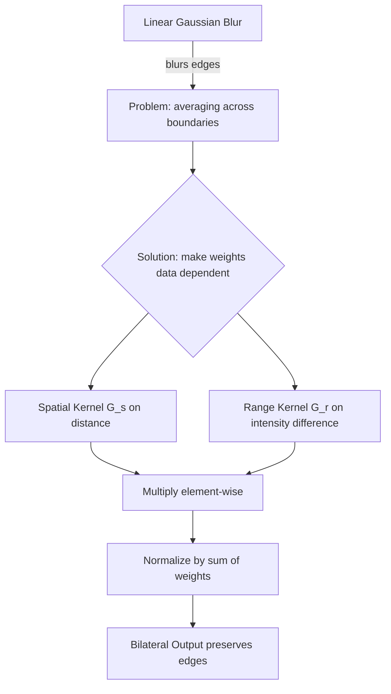

# 25. Bilateral Filtering - Complete Mathematical Theory, Implementation, and Practice

> Deep-dive library reference for the bilateral filter. The course-theory view lives in [[02.7. Non-Linear Boundary-Preserving Filtering (Bilateral Joint Spatial-Radiometric Filter)]]; the sibling operator note is [[20. Non-Linear and Edge-Preserving Filtering - Median, Bilateral, and Nagao Filters]] and the multi-implementation Nagao reference is [[26. Nagao Filtering - Multi-Implementation Reference with Hardcoded Kernels, Vectorized, and Convolution Approaches]]. The canonical from-scratch implementation is `filtrebilateral` in `APSD_TAI_LAB/TAI/utils/filters.py` — the one executed by the TP2 benchmark notebook; Section 6.1 embeds it byte-identically and Section 9 verifies its agreement with `cv2.bilateralFilter`.

## 1. Overview

The bilateral filter is an edge-preserving smoothing operator that replaces each pixel with a weighted average of its neighbors, where the weights depend on **two independent criteria**:

1. **Spatial closeness** — nearby pixels matter more than distant ones (a Gaussian on geometric distance).
2. **Radiometric similarity** — pixels whose intensity is close to the center pixel matter more than pixels whose intensity differs strongly (a Gaussian on intensity difference).

Because criterion 2 shuts down contributions from the far side of an edge, the filter smooths noise **inside** homogeneous regions while refusing to average **across** boundaries. This note develops the theory from first principles, then builds the implementation twice — once from scratch in NumPy, once through the OpenCV API — and closes with parameters, complexity, artifacts, and applications.



## 2. Why Linear Filters Fail: A Quantitative Motivation

A linear smoothing filter computes a fixed weighted sum: the weights depend only on position, never on the pixel values themselves. Consider the 1-D signal (a step edge between positions 2 and 3):

```text
index:     0    1    2    3    4
value:    50   52   51  150  148
                     ^
                center pixel p = 2, true value 51
```

Filtering position 2 with a spatial Gaussian ($\sigma_s = 1$) gives weights $G_s = [0.1353, 0.6065, 1.0000, 0.6065, 0.1353]$ (sum $= 2.4837$). The linear output is:

$$I_{\text{Gauss}}(2) = \frac{50 \cdot 0.1353 + 52 \cdot 0.6065 + 51 \cdot 1 + 150 \cdot 0.6065 + 148 \cdot 0.1353}{2.4837} = 80.65$$

The true value is $51$; the Gaussian commits an **error of $+29.65$ gray levels** because the bright samples on the other side of the edge contaminate the average. No choice of $\sigma_s$ fixes this: any non-trivial spatial kernel straddling the edge mixes both populations. The remedy must make the weights depend on the data.

## 3. The Core Idea: A Product of Two Gaussians

The bilateral filter keeps the spatial Gaussian but multiplies it by a **range Gaussian** evaluated on the intensity difference to the center pixel:

$$\boxed{\ I_{\text{bilateral}}(p) = \frac{1}{W_p} \sum_{q \in S} I(q) \cdot \underbrace{G_{\sigma_s}\big(\|p - q\|\big)}_{\text{spatial}} \cdot \underbrace{G_{\sigma_r}\big(|I(p) - I(q)|\big)}_{\text{range}}\ }$$

with the two Gaussian kernels

$$G_{\sigma_s}(\|p - q\|) = \exp\left(-\frac{\|p - q\|^2}{2\sigma_s^2}\right), \qquad G_{\sigma_r}(|I(p) - I(q)|) = \exp\left(-\frac{|I(p) - I(q)|^2}{2\sigma_r^2}\right)$$

and the normalization factor

$$W_p = \sum_{q \in S} G_{\sigma_s}(\|p - q\|) \cdot G_{\sigma_r}(|I(p) - I(q)|).$$

Interpretation of every symbol:

* $p = (y, x)$: the pixel being filtered; $I(p)$ its intensity.
* $q$: any pixel in the spatial support $S$ (a $(2r+1) \times (2r+1)$ square or a discretized disk of diameter $d$).
* $\|p - q\|$: Euclidean geometric distance between pixel sites.
* $|I(p) - I(q)|$: absolute radiometric difference between pixel values.
* $W_p$: the sum of the final weights, guaranteeing the coefficients sum to $1$ (a proper weighted average).

### 3.1 The Same Edge, Bilaterally Filtered (Verified Numbers)

Repeating the 1-D example with $\sigma_s = 1$ and $\sigma_r = 25$:

```text
|I(q) - I(p)| :     1        1      0      99      97
G_r          :  0.99920  0.99920  1.0000  0.00039  0.00054
G_s * G_r    :  0.13523  0.60605  1.0000  0.00024  0.00007    (sum = 1.7416)
```

$$I_{\text{bilateral}}(2) = \frac{50 \cdot 0.13523 + 52 \cdot 0.60605 + 51 \cdot 1 + 150 \cdot 0.00024 + 148 \cdot 0.00007}{1.7416} = 51.29$$

The error collapses from $+29.65$ to $+0.29$. The bright samples at distance $99$ and $97$ gray levels are crushed by factors of roughly $2500\times$ and $1900\times$, so the output is essentially the average of the three dark samples — computed **without any explicit edge detector**.

## 4. Properties of the Operator

1. **Non-linear and data-dependent.** The effective kernel $G_{\sigma_s} \cdot G_{\sigma_r}$ changes per pixel; superposition does not hold. This is why bilateral filtering cannot be implemented as a single convolution.
2. **Convex combination.** All weights are positive and $W_p$ normalizes them to sum to $1$, so the output is always inside the convex hull of the neighborhood intensities: **the filter cannot invent new intensities, overshoot, or ring** (unlike ideal frequency-domain filters).
3. **Identity on constant images.** If the neighborhood is perfectly flat, every range weight is $1$ and the output equals the input mean, which equals the input.
4. **Edge preservation mechanism.** Across a step edge of height $h$, the cross-edge weight carries the factor $\exp(-h^2 / 2\sigma_r^2)$: a 100-level edge with $\sigma_r = 25$ attenuates cross-edge influence by $\approx 2500\times$.
5. **Iterativity.** Applying the filter $n$ times drives regions toward piecewise constancy (a crude segmentation). Repeated application amplifies the artifacts of Section 11.
6. **Relation to anisotropic diffusion.** One time-step of Perona-Malik diffusion with a Gaussian spatial term is a first-order approximation of one bilateral filtering pass; iterating the bilateral filter is a discrete approximation of the full diffusion process (see [[02.8. Partial Differential Equations in Restoration (Perona-Malik Anisotropic Diffusion)]]).

## 5. Parameter Analysis

| Parameter | Role | Small value | Large value |
| :--- | :--- | :--- | :--- |
| $d$ (diameter) | Spatial support, $d = 2r + 1$ | Few neighbors averaged, weak denoising | More candidates, better noise suppression, higher cost |
| $\sigma_s$ | Spatial Gaussian spread | Only immediate vicinity counts | Distant pixels contribute; approaches non-local averaging |
| $\sigma_r$ | Range Gaussian spread | Only near-identical intensities mix: strong edge preservation, weak smoothing | Range kernel flattens toward $1$ |

### 5.1 Limit Behaviors (Sanity Checks)

* **$\sigma_r \to \infty$:** $G_{\sigma_r} \to 1$ for every pair, the range factor vanishes and the filter degenerates **exactly** into a plain Gaussian blur (verified numerically: both give $80.6510$ on the 1-D example).
* **$\sigma_r \to 0$:** only pixels with $I(q) = I(p)$ survive; the filter approaches the identity (perfect edge preservation, no smoothing).
* **$\sigma_s \to \infty$ with finite $\sigma_r$:** every pixel of the image competes with equal spatial weight; the filter converges toward a **piecewise-constant mean-shift-like** behavior.

### 5.2 Choosing Values in Practice

* $\sigma_r$ should match the **noise standard deviation** you want to absorb, and stay well below the edge heights you want to keep: $\sigma_{\text{noise}} \lesssim \sigma_r \ll h_{\text{edge}}$. For 8-bit images, $\sigma_r \in [25, 75]$ is a common starting range.
* $\sigma_s$ (or $d$) controls how far the filter searches for similar pixels: a few pixels ($d = 5 \ldots 9$) for fine texture, larger ($d \geq 15$) for coarse blotches — at quadratic cost.
* Denoise first, then threshold: filtering **before** Otsu binarization stabilizes the inter-class variance computation (see [[07.2. Global Optimal Statistical Thresholding (Otsu's Method Derivation)]]).

## 6. From-Scratch Implementation: Canonical and Pedagogical Forms

Two NumPy implementations cover both needs. The **canonical lab implementation `filtrebilateral`** — defined in `APSD_TAI_LAB/TAI/utils/filters.py` and executed by the TP2 benchmark notebook (`TAI/02_TP2_Noise_and_Spatial_Filtering/notebooks/02_spatial_filtering_and_psnr.ipynb`) — is the vectorized shift-accumulation form embedded below. The **pedagogical per-pixel translation** `bilateral_naive` (Section 6.2) keeps the formula readable line by line, exactly the role `filtreMoyenne_naif_boucles` plays for the mean filter. The two compute the identical operator: their outputs differ by at most **0 gray levels** on random 8-bit tests (verified, Section 9) — the vectorized form is a pure speed optimization (measured: 1.3 ms vs 17.0 ms on a $48 \times 48$ image, 26 ms on $256 \times 256$).

### 6.1 The Canonical Lab Implementation (`filtrebilateral`)

The code below is the module's `_validate_odd` + `filtrebilateral`, byte-identical (imports added so the block runs standalone):

```python
import math

import numpy as np


def _validate_odd(k: int) -> None:
    if k % 2 == 0:
        raise ValueError(f"Window size must be odd, got {k}.")


def filtrebilateral(image, taille_fenetre: int, sigma_s: float, sigma_r: float) -> np.ndarray:
    """Bilateral filter: Gaussian-weighted mean in *both* space and intensity.

    w(p, q) = exp(-||p - q||^2 / (2 sigma_s^2)) * exp(-(I(p) - I(q))^2 / (2 sigma_r^2))

    The range term keeps strong edges sharp (large intensity differences get
    near-zero weight) while flat regions are smoothed like a Gaussian blur.
    """
    _validate_odd(taille_fenetre)
    r = taille_fenetre // 2
    h, w = image.shape
    img_f = image.astype(np.float64)
    padded = np.pad(img_f, r, mode="reflect")
    sum_weights = np.zeros((h, w), dtype=np.float64)
    sum_values = np.zeros((h, w), dtype=np.float64)
    inv_2s2 = -1.0 / (2.0 * sigma_s * sigma_s)
    inv_2r2 = -1.0 / (2.0 * sigma_r * sigma_r)
    for dy in range(-r, r + 1):
        for dx in range(-r, r + 1):
            neighbor = padded[r + dy:r + dy + h, r + dx:r + dx + w]
            spatial_w = math.exp((dy * dy + dx * dx) * inv_2s2)
            color_diff = neighbor - img_f
            color_w = np.exp((color_diff * color_diff) * inv_2r2)
            w_tot = spatial_w * color_w
            sum_weights += w_tot
            sum_values += w_tot * neighbor
    return np.clip(
        np.round(sum_values / np.maximum(sum_weights, 1e-12)), 0, 255
    ).astype(np.uint8)
```

How the shift-accumulation pattern works:

* The loops enumerate the $d^2$ window **offsets** $(dy, dx)$ — not pixels. For each offset, the whole shifted image `neighbor` is processed at once by vectorized NumPy operations.
* The spatial weight `spatial_w` is a **scalar** per offset — one `math.exp` per offset, not per pixel; the range weight `color_w` is one vectorized `np.exp` over the whole image.
* `sum_weights` and `sum_values` accumulate $W_p$ and the numerator of the formula for **all pixels simultaneously**; the final division, rounding, and clipping map back to `uint8`. `np.maximum(sum_weights, 1e-12)` guards the pathological case of an all-underflow weight sum.
* Padding is `mode="reflect"` — the NumPy equivalent of OpenCV's default `borderType=cv2.BORDER_REFLECT_101`, the same convention as every filter in `TAI/utils/filters.py`.
* The window is the full $(2r+1) \times (2r+1)$ **square**. OpenCV, by contrast, drops the corner offsets and uses a **disk** — a real semantic difference quantified in Section 7.1.

### 6.2 The Pedagogical Per-Pixel Translation (`bilateral_naive`)

```python
import numpy as np

def bilateral_naive(img: np.ndarray, d: int = 9,
                    sigma_s: float = 75.0, sigma_r: float = 75.0) -> np.ndarray:
    """O(d^2)-per-pixel bilateral filter for grayscale images.

    img     : 2-D uint8 array
    d       : odd window diameter (2r + 1)
    sigma_s : spatial Gaussian standard deviation (pixels)
    sigma_r : range Gaussian standard deviation (gray levels)
    """
    h, w = img.shape
    r = d // 2
    f = img.astype(np.float64)          # float64: keeps 255^2 sums exact
    padded = np.pad(f, r, mode="reflect")

    # Spatial kernel: data-INdependent -> precompute once
    yy, xx = np.mgrid[-r:r + 1, -r:r + 1]
    Gs = np.exp(-(xx ** 2 + yy ** 2) / (2 * sigma_s ** 2))   # (d, d)

    out = np.zeros((h, w))
    for y in range(h):
        for x in range(w):
            patch = padded[y:y + d, x:x + d]                  # neighborhood
            # Range kernel: data-DEPENDENT -> recompute per pixel
            Gr = np.exp(-((patch - f[y, x]) ** 2) / (2 * sigma_r ** 2))
            wgt = Gs * Gr                                     # bilateral weights
            out[y, x] = (patch * wgt).sum() / wgt.sum()       # normalized average
    return np.clip(np.rint(out), 0, 255).astype(np.uint8)
```

Every line maps to the formula: `patch` enumerates $q \in S$, `Gs` is $G_{\sigma_s}$, `Gr` is $G_{\sigma_r}$, `wgt.sum()` is $W_p$. Verified against the canonical form: identical outputs (max difference 0) — use it to *read* the formula, use `filtrebilateral` to *run* it.

### 6.3 The Range-LUT Optimization (Optional)

For 8-bit images, $|I(p) - I(q)|$ can only take $256$ values, so all possible range weights fit in a lookup table computed once:

```python
import numpy as np

sigma_r = 40.0
diffs = np.arange(256)                       # every possible |I(p) - I(q)|
range_lut = np.exp(-(diffs ** 2) / (2 * sigma_r ** 2))
# per pixel:  Gr = range_lut[np.abs(patch - center).astype(np.uint8)]
```

With $\sigma_r = 40$: $G_r(0) = 1.0000$, $G_r(20) = 0.8825$, $G_r(60) = 0.3247$, $G_r(120) = 0.0111$. This replaces a transcendental `exp` per neighbor with one array indexing — OpenCV's C++ core precomputes exactly this table for 8-bit inputs (`color_weight[i] = (float)std::exp(i*i*gauss_color_coeff)` in `bilateral_filter.dispatch.cpp`, consumed as `color_weight[std::abs(val - val0)]` in the inner loop).

**Positioning (do not confuse the two):** the LUT is an *optional optimization* for per-pixel-loop implementations, NOT part of the canonical `filtrebilateral` — the lab's shift-accumulation form already eliminates per-pixel Python overhead by calling vectorized `np.exp` once per offset, so it does not need a table at all.

### 6.4 Complexity

Per pixel the filter touches $d^2$ neighbors and does $3d^2$ multiply-adds (weights, weighted values, normalization): total $\Theta(HWd^2)$. A $512 \times 512$ image with $d = 9$ performs $\approx 21$ million weight evaluations in the naive version — the motivation behind both the LUT and the fast bilateral grid approximations (Section 10).

## 7. The OpenCV API

```python
import cv2
import numpy as np

img = np.random.default_rng(0).integers(0, 256, (16, 16), dtype=np.uint8)

clean = cv2.bilateralFilter(
    src=img,             # input: 1- or 3-channel 8-bit / float image
    d=9,                 # filter diameter; d <= 0 -> derived from sigmaSpace
    sigmaColor=75,       # sigma_r: range filter, in color/intensity units
    sigmaSpace=75,       # sigma_s: spatial filter, in pixels
    borderType=cv2.BORDER_REFLECT_101,   # this IS the default (BORDER_DEFAULT)
)
```

Semantics worth memorizing:

* `d` and `sigmaSpace` are coupled: if `d <= 0`, OpenCV derives the window from `sigmaSpace` (round to odd). Passing `d = 9` explicitly pins the cost.
* For **color images**, the range distance is the Euclidean norm of the RGB difference vector — three coupled 1-D Gaussians are not used. If you want perceptual edge preservation, convert to CIELAB first (`cv2.cvtColor(..., cv2.COLOR_BGR2LAB)`) so the range kernel measures perceptual distance (see [[15. OpenCV Core Architecture - Matrix Representation, Channels, and Color Constellations]]).
* Border handling defaults to `BORDER_REFLECT_101`, matching `np.pad(mode="reflect")` — the same convention the Nagao implementations rely on in [[26. Nagao Filtering - Multi-Implementation Reference with Hardcoded Kernels, Vectorized, and Convolution Approaches]].

### 7.1 The Disk-Shaped Spatial Window (a real semantic difference)

OpenCV does **not** use the full $(2r+1) \times (2r+1)$ square: when it builds the spatial kernel it skips every offset whose Euclidean distance from the center exceeds the radius (from `bilateral_filter.dispatch.cpp`):

```cpp
double r = std::sqrt((double)i*i + (double)j*j);
if( r > radius )
    continue;
space_weight[maxk] = (float)std::exp(r*r*gauss_space_coeff);
```

Consequences, all verified empirically (OpenCV 4.13.0, seeded random $48 \times 48$ uint8):

* The spatial support is the **inscribed disk**, not the square: for `d = 7` the disk keeps only 29 of the 49 square offsets (the 20 corner offsets — $(\pm 3, \pm 1)$-type diagonals at distance $> 3$ — are dropped).
* The canonical `filtrebilateral` (square window) therefore deviates from `cv2.bilateralFilter` by up to **14 gray levels at `d = 7`** (mean 1.74) with identical `sigma` values, while at `d = 9` the deviation shrinks to max 6 (mean 0.76) — the disk excludes proportionally less weight as `d` grows.
* Replace the square support with the same disk rule in a manual implementation and the deviation vanishes **entirely**: bit-exact agreement with `cv2.bilateralFilter` (max 0, mean 0.0000) at `d = 7/9/11`, including border pixels. The two OpenCV-vs-from-scratch differences are therefore (i) the disk window, (ii) float32 weight-table rounding — not a different operator.

Typical parameter presets for course-scale work:

```python
light    = cv2.bilateralFilter(img, d=5,  sigmaColor=50, sigmaSpace=50)  # light touch
standard = cv2.bilateralFilter(img, d=9,  sigmaColor=75, sigmaSpace=75)  # standard
course   = cv2.bilateralFilter(img, d=7,  sigmaColor=40, sigmaSpace=40)  # TP2 course preset (tp2_enonce_fr Ex. 2 d)
auto     = cv2.bilateralFilter(img, d=-1, sigmaColor=80, sigmaSpace=80)  # auto window
```

The `d=7, sigmaColor=40, sigmaSpace=40` preset is not arbitrary: it is the instructor's prescribed setting for the TP2 benchmark (`tp2_enonce_fr.pdf`, Exercise 2, item d: "Filtre bilatérale : d=7, sigmaColor=40, sigmaSpace=40").

## 8. Color Bilateral Filtering

For vector-valued pixels $I(p) \in \mathbb{R}^C$, the range kernel generalizes to the Euclidean distance in channel space:

$$G_{\sigma_r}\big(\|I(p) - I(q)\|_2\big) = \exp\left(-\frac{\|I(p) - I(q)\|_2^2}{2\sigma_r^2}\right)$$

The spatial kernel is unchanged. Edges in **any** channel (luminance or chrominance) suppress cross-edge averaging, which is why the color version removes chroma noise (color speckle) that a per-channel grayscale filter would smear.

```python
bgr = cv2.cvtColor(img, cv2.COLOR_GRAY2BGR)
lab = cv2.cvtColor(bgr, cv2.COLOR_BGR2LAB).astype(np.float32)
# ... apply bilateral in a vectorized loop or via cv2 on the BGR image ...
```

## 9. Verified Agreement Between Implementations

All checks on the same seeded random $48 \times 48$ uint8 image (`np.random.default_rng(24)`), OpenCV 4.13.0, identical $\sigma$ values for both sides ($\sigma_s = 2$, $\sigma_r = 40$):

| Comparison | $d = 9$ | $d = 7$ |
| :--- | :--- | :--- |
| `bilateral_naive` vs `filtrebilateral` (canonical) | max 0, mean 0.0000 | max 0, mean 0.0000 |
| square window (`filtrebilateral`) vs `cv2.bilateralFilter` | max 6, mean 0.76 | max 14, mean 1.74 |
| disk window (manual, OpenCV's rule) vs `cv2.bilateralFilter` | max 0, mean 0.0000 | max 0, mean 0.0000 |

Reading of the three rows:

1. **The two from-scratch forms are the same operator** — the per-pixel translation and the vectorized shift-accumulation agree bit-for-bit; the latter is purely a speed optimization (Section 6).
2. **The from-scratch-vs-OpenCV residual is the window shape, not the operator.** OpenCV's disk support (Section 7.1) drops corner offsets the square form keeps; with identical $\sigma$s the deviation peaks at 14 levels for `d = 7` (where the disk keeps only 29 of 49 offsets) and shrinks to 6 levels at `d = 9`.
3. **Adopting OpenCV's disk rule reproduces `cv2.bilateralFilter` exactly** (max 0 over the whole image, borders included — the `mode="reflect"` padding matches its `BORDER_REFLECT_101` default).

On the TP2 laboratory images (cameraman + Gaussian noise $\sigma^2 = 100$, seed 42 — deterministic reproduction of the notebook inputs), the lab's own comparison is by design *cross-parameter*: the instructor's OpenCV preset `cv2.bilateralFilter(im2, 7, 40, 40)` against the canonical `filtrebilateral(im2, 7, 2.0, 40.0)`:

* PSNR between the two outputs: **47.05 dB** — similar behaviour, not near-identity (different spatial sigma **and** different window shape);
* against the clean reference: $30.03$ dB (OpenCV preset) vs $30.29$ dB (canonical form) — both recover about $2$ dB over the noisy baseline of $28.13$ dB.

Such cross-implementation equivalence checks (compare against `np.testing.assert_allclose`, or bound the max deviation) are the standard way to trust a hand-written filter; the same discipline is applied to all four Nagao implementations in [[26. Nagao Filtering - Multi-Implementation Reference with Hardcoded Kernels, Vectorized, and Convolution Approaches]].

## 10. Computational Optimizations (Conceptual Map)

| Technique | Idea | Cost |
| :--- | :--- | :--- |
| Range LUT (Section 6.2) | Precompute all 256 range weights for 8-bit input | removes `exp` from inner loop |
| Separable spatial term | $G_{\sigma_s} = g_x \cdot g_y$ factorization | halves spatial multiplications |
| Bilateral grid (Paris & Durand) | Scatter pixels into a 3-D $(x, y, \text{intensity})$ grid, blur the grid, slice back | near-linear in pixels, sub-percent error |
| Intensity quantization | Bin intensities into $k \ll 256$ levels, one kernel per bin | controllable approximation error |

The first two are drop-in for course work; the bilateral grid matters for real-time video and HDR tone mapping.

## 11. Artifacts and Pitfalls

1. **Staircasing:** iterating the filter turns smooth gradients into terraces of constant value (the piecewise-constant attractor of Section 4).
2. **Gradient reversal:** on smooth ramps, the filter can round a ramp *past* the value of the next plateau, inverting the local gradient — the classic "cartoon outline" artifact.
3. **Halos around strong edges** when $\sigma_r$ is too small relative to the noise: the filter refuses to mix legitimately noisy pixels and leaves high-variance fringes.
4. **Impulse noise is NOT removed:** a salt-and-pepper outlier has a huge intensity difference from the center, so its range weight is $\approx 0$ — it never enters the average, but the outlier *itself* is also barely filtered when it is the center pixel (its neighborhood is dissimilar to it). Use the **median** filter first for impulse noise (see [[20. Non-Linear and Edge-Preserving Filtering - Median, Bilateral, and Nagao Filters]]), then bilateral for Gaussian noise.

## 12. Practical Applications

* **Pre-segmentation smoothing:** denoise before Otsu / Sauvola binarization so the threshold statistics are computed on clean bimodal histograms (course pipeline of [[10.4. Project - End-to-End Historical Document Restoration and Extraction Pipeline]]).
* **Medical and microscopy denoising:** Gaussian sensor noise on near-piecewise-constant tissue slides; bilateral keeps lesion boundaries measurable for the descriptors of [[07.7. Geometric Region Descriptors (AABB, OBB, Centroids, and Central Moments)]].
* **Detail decomposition / tone mapping:** image = bilateral base + residual detail; compress the base's dynamic range (CLAHE-style radiometry in [[18. Visual Frequency and Radiometry - Histograms, Equalization, AHE, and CLAHE]]) and re-add the detail.
* **Flash / no-flash fusion:** transfer color from a clean flash photo to a dark noisy photo by averaging only radiometrically similar pixels.
* **Preprocessing before PSNR/SSIM benchmarking pipelines** — restoration quality is measured with the metrics of [[22. Objective Image Quality Assessment - MSE, PSNR, and SSIM Metrics]].

## 13. Bilateral vs. the Other Edge-Preserving Operators

| Property | Gaussian | Median | Bilateral | Nagao | Perona-Malik |
| :--- | :--- | :--- | :--- | :--- | :--- |
| Linear | yes | no | no | no | no (PDE) |
| Kernel depends on data | no | no (rank) | yes (radiometric) | yes (variance-selected sector) | yes (gradient-driven conductivity) |
| Edge preservation | none | partial | strong | strong + orientation-aware | strong |
| Impulse noise | poor | excellent | poor | moderate | poor |
| Cost per pixel | $O(d^2)$ | $O(d^2 \log d)$ | $O(d^2)$ + exp | $O(61)$ fixed | $O(d^2)$ per iteration |

## 14. Connections to Other Topics

* Course theory note: [[02.7. Non-Linear Boundary-Preserving Filtering (Bilateral Joint Spatial-Radiometric Filter)]].
* Family overview with median filter: [[20. Non-Linear and Edge-Preserving Filtering - Median, Bilateral, and Nagao Filters]].
* Sibling multi-implementation reference: [[26. Nagao Filtering - Multi-Implementation Reference with Hardcoded Kernels, Vectorized, and Convolution Approaches]].
* PDE viewpoint: [[02.8. Partial Differential Equations in Restoration (Perona-Malik Anisotropic Diffusion)]].
* Noise models that motivate it: [[19. Spatial Image Restoration - Noise Models, Linear Convolution, and Fast Integral Filters]].
* Quality metrics to evaluate it: [[22. Objective Image Quality Assessment - MSE, PSNR, and SSIM Metrics]].
* TP2 laboratory walkthrough (noise models, the mean/median/bilateral benchmark with PSNR and runtimes that executes `filtrebilateral`): [[09.3. TP2 Part 1 - Discrete Noise Models and Spatial Convolution Smoothing]].

---
